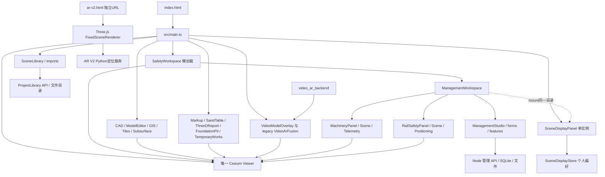

# 第一阶段：权威归属、重复维护与模块依赖

基准：`4a5d7c7cdecc31846201d0cf2e0ba7b8d9fc3acc`。下表“目标中心”是V2归属建议；“现有写入者/存储”才是当前实现。不能把设计目标直接当成现状。

## 1. 真实功能归属矩阵

| 业务/对象 | 当前权威写入者与存储 | V2唯一权威中心 | 可引用中心与迁移限制 |
|---|---|---|---|
| 项目/成员/任务授权 | ManagementStore SQLite projects/成员相关表；另有DigitalTwinDataCenter固定current-project | 项目管理公共项目上下文 | 六中心引用；先确认两个项目身份如何映射，不能按名称拼接 |
| 工点/WBS/任务/计划/实绩/周承诺/基线 | management/domain.ts命令，SQLite管理记录 | 项目管理 | 施工、安全、巡检、监测通过taskId引用 |
| 沙盘进度任务 | SandTableProjectControl本地独立task列表，非上述任务 | 项目管理；需保留兼容读 | 先呈现“沙盘本机任务”来源，再设计关联/迁移，不能无声替代 |
| 倾斜摄影/模型/CAD/GIS原件与派生文件 | SceneLibrary → ProjectLibrary records/<id>；转换缓存和外部目录另存 | 工程场景资源服务 | 所有中心引用；当前LibraryRecord不具备通用projectId |
| 图层加载实例/模型transform | main imports、ModelEditor、LibraryRecord.settings共享同ID语义 | 公共场景宿主/场景实例 | 设计ResourceAsset与SceneInstance分离是后续工作，目前不能宣称已有两张表 |
| 图层显示/标签/自定义分组 | SceneDisplayStore按[projectId,actorId]；另有record.visible/专业visible | 公共场景显示偏好 | 各中心只调用；保留业务状态与个人显示的区别 |
| 机械身份/编号/模型参数/位置 | SQLite resources，resources.machinery；MachineryPanel编辑 | 施工管理/施工机械 | 项目资源表引用同记录；安全不得再建机械尺寸主记录 |
| 机械证件/检验资料 | MachineryDocumentsPanel + 管理文件/证件记录 | 施工管理/机械资料；文件字节仍项目资料服务 | RailSafety复用面板；是有效复用，不应为安全复制表单 |
| 机械运行绑定/人工与实测姿态 | SQLite resources.machinery保存初始模型参数/姿态，resources.manageSensors保存传感器管理选择；Controller将运行{enabled,config}（字段绑定、换算和过期参数）按actor/project/resource存localStorage；Gateway私有配置保存外部设备凭据绑定，采样帧在内存 | 施工管理/运行监测 | 安全读取带source/time/quality的状态；长期历史不是已有服务端时序库 |
| 机械倾覆/侵限配置与筛查 | railSafety machine配置引用resourceId；几何Worker、风险计算/登记 | 安全管控 | 施工仅快捷打开；筛查结果不等于现场验收 |
| 铁路限界/防护人员/工作区 | railSafety业务记录/positioning Gateway/场景适配 | 安全管控 | 工程场景显示、监测读取状态；当前多项目能力受safety:project限制 |
| 通用检查/验收/问题/整改/复核 | SQLite checks/issues/命令工作流 | 项目管理（通用质量）/安全管控（安全事件语义） | 入口按语义分，底层对象不因中心拆分而复制 |
| 旧安全空间对象/事件 | safety-spatial.json；safety-events.json只作历史只读输入，新事件写SQLite issues | 安全管控；工点空间按关系复用 | 保留legacy接口/事件桥，不删除历史；详04 |
| 专业临建方案 | TemporaryWorksPanel/Store，IndexedDB plans按项目和id | 施工管理/临建设施 | 场景只显示；方案保存/编辑/自动初始高度算法保留 |
| 沙盘围栏/硬化/临时建筑/车辆线路 | SandTableFacilities固定项目浏览器存储 | 施工管理/施工布置 | 与专业临建不是同一Plan；迁移前须保留旧对象 |
| 基坑/点位/手工读数/阈值 | FoundationPitMonitoring固定localStorage，结构无projectId | 智能监测 | 场景/安全读取；显示作用域不是业务隔离，不能直接承诺多项目监测 |
| 巡检任务/证据/管理发现 | SQLite inspections/evidence/issues + management-files/Library引用 | 智能巡检（任务成果）；文件字节项目资料服务 | 安全/项目引用；不存在完整无人机自动任务执行平台 |
| 视频/航迹/融合方案/缓存 | VideoModelOverlay与legacy VideoArFusion；LibraryRecord + 浏览器缓存 | 智能巡检 | 共享资源但模式不同；不删除legacy解码/投影链 |
| AR视觉定位/参考/SfM | ar_v2 Python +独立Three.js页面；项目配置/数据目录 | 智能巡检/高级定位 | 原URL和服务边界先保留，不能以单Viewer要求删除独立工具 |
| 标绘/立面贴图 | MarkupTools localStorage + IndexedDB纹理 | 工程场景/空间标绘 | 跨中心引用；后续须补项目/用户隔离契约 |
| 隐蔽工程档案/前后照片 | SubsurfaceTools IndexedDB hidden-works | 项目管理/资料协同 | 现场取点留工程场景；不能当已进入management-files版本体系 |
| 沙盘视角/表现/汇报页 | ElectronicSandTable/Presentation/ThreeDReport，本地键/会话媒体 | 工程场景 | 项目、安全汇报引用，避免与管理JSON报告混淆 |
| 发布文件检查/显示对照/诊断记录 | ModelQualityTracker + SafetyModelOptimization/server检查服务 | 工程场景/模型诊断 | 已有只读检查/同镜头对照应适配；候选/验证/激活/回滚为PIPELINE_UNAVAILABLE，修复任务中心仍为目标 |

详细源文件、入口、权限、测试、实现状态逐项见01、03、04。以上覆盖业务数据权威，而不是简单按源码目录分配中心。

## 2. 重复入口、配置与数据维护清单

类型：入口复用=多个入口调用同对象，可保留快捷入口；独立数据=同类概念存在不同存储；配置重叠=同视觉/状态有多层开关；历史兼容=旧实现仍有调用方。

| ID | 重复项与证据 | 类型 / 影响 | 审计裁决与后续建议（未实施） |
|---|---|---|---|
| D01 | 顶部machinery、场景机械条目编辑、管理资源表、三维现场机械按钮；main:2650,3352，managementWorkspace:444 | 入口复用 | 已复用MachineryPanel/资源记录，不应再建“施工机械中心表单” |
| D02 | rail-safety标签、reopenRailSafety、现场列表/风险详情；main:2657,3354,3432 | 入口复用 | 安全中心成为权威入口，施工/场景保留携带resourceId的快捷调用 |
| D03 | RailSafety与Machinery的机械资料面板 | 入口复用 | MachineryDocumentsPanel共用，既有复用应保留；记录字段/权限见03 |
| D04 | 原图层目录、SceneDisplayPanel、电子沙盘图层、管理“图层与显示”、视频对象选择 | 配置重叠 | 非全部重复数据。目录个人偏好、资源visible、AR有效显示不同；统一调度不能丢掉AR临时遮挡和权限裁剪（main:1071,3364,3412） |
| D05 | 标绘列表可见按钮/基坑总开关与场景目录 | 入口复用 | main:3445,3452以捕获事件统一写显示Store，避免重复绑定与双写 |
| D06 | 临建内部changePlanVisibility vs 场景setPlanVisible | 配置重叠 | temporaryWorksPanel:729的setPlanVisible写override，:747的changePlanVisibility保存新方案plan.visible后调用前者；需明确个人偏好与业务默认显示 |
| D07 | “平台总览”项目资料 vs 管理驾驶舱项目资料 | 独立数据 | current-project浏览器目录与SQLite projects不同；不是双入口同记录（main:1559，digitalTwinDataCenter:221） |
| D08 | 沙盘任务/进度 vs SQLite tasks/plans/actuals | 独立数据 | sandTableProjectControl:139,626无taskId同步契约；保留旧数据，建立明确对应关系后才可迁移 |
| D09 | 沙盘风险 vs railSafety筛查 vs safety-events vs management issues | 独立数据 | 风险展示、计算结果、事件、整改问题分别建模；事件桥可用但非全局去重依据 |
| D10 | 沙盘硬化/临时建筑 vs TemporaryWorks专业场坪/驻地/道路 | 独立数据 | 两套几何、参数、存储、ID；不能以“同名功能”删除老方案（sandTableFacilities:24,1012） |
| D11 | Subsurface隐蔽档案 vs 项目资料文件/版本 vs 巡检证据 | 独立数据 | IndexedDB照片、management-files、Library原件不是同一版本链；先支持链接/来源标记 |
| D12 | 主VideoModelOverlay vs 隐藏VideoArFusion vs AR V2 | 历史兼容 | CC融合、共享回放/表面投影、视觉定位不同输入和坐标合同，不能据“视频AR”同名直接合并 |
| D13 | ?screen=safety / ?screen=management / 现场按钮 | 入口复用 | 当前都经openSafetyWorkspace；interface=legacy才选旧宿主（main:3422,3464）；兼容URL必须保留 |
| D14 | SceneDisplayPanel两个DOM宿主 | 入口复用 | mount移动同一root，已有单实例；新panel registry不得重新new（main:3222,3441） |
| D15 | DigitalTwinDataCenter目录 vs SceneDisplayStore目录 | 不同职责但易误并 | 前者汇总项目/资源/业务元数据，后者个人显隐/分组；两者都不应变成业务唯一存储 |
| D16 | 三维汇报 / 管理报告 / 风险视频 / CSV/过程表 | 导出名称重叠 | 三维JSON、固定JSON快照、媒体导出、数据表是不同产品，统一“导出”按钮须保留格式和来源 |
| D17 | 多模块坐标/高程/旋转输入 | 配置重叠 | CAD local/EPSG/Gauss、模型坐标、临建ENU、机械椭球高、AR相机坐标不同；先保留原校验和坐标服务适配 |
| D18 | new项目上下文 vs 固定 safety:project/current-project/current-digital-twin-project/workbench-local | 独立身份 | 统一导航前先定义项目能力范围，不能将固定ID替换为任意选中ID就当完成迁移 |
| D19 | 原安全Dashboard、V3及presentationV4/V5 | 历史兼容 | 查调用链而非目录名清理；旧安全适配器/效果仍为管理三维宿主依赖（03） |
| D20 | 软件version=1.2.0、临建1.1.0功能称谓、sourceCommit、acceptance/candidate部署标识 | 配置/版本口径重叠 | 报告分别记录，不用package版本覆盖用户运行版本；部署元信息不是运行进程证明 |
| D21 | pnpm-lock与package-lock；启动/更新/AR部署的工具链 | 配置重叠 | 本阶段全部保留，后续独立决策统一锁文件/运行时；不能用一次install改写现有依赖 |
| D22 | “移除”图层、“删除”资料、“移除模型”、临建删除、归档任务 | 操作名称重叠 | 必须按下面生命周期表拆语义，不能共用无差别DELETE |

## 3. Viewer 所有权与真实依赖图

静态证据：在生产 `src/` 与 `ar_v2/` 扫描 `new Viewer` / `new Cesium.Viewer`，Cesium仅 `src/main.ts:359` 构造一次；依赖注入和构造器逐项核验如下。测试夹具的独立Viewer不属于生产页面。

箭头表示主要依赖/资源引用，不是调用时间顺序。`dependency-edges.tsv`含2,484条TS/JS词法import引用（包括测试、外部包及CSS，可能包含类型导入/重复引用），用于定位耦合；Python依赖、脚本和第三方运行要求见05，不把词法边数当真实运行依赖数。

| 对象/宿主 | 创建与引用证据 | 现有释放/切换合同 | V2适配要求 |
|---|---|---|---|
| Viewer | main:359；SafetyWorkspace options.viewer（main:3167） | 面板切换不new Viewer | 平台宿主持有；模块只借用 |
| ManagementWorkspace | main:3219缓存Promise；由SafetyWorkspace取viewer | prepareWorkbenchNavigation/guardNavigation、changeMode、close、dispose | 不能绕过机械/安全草稿检查、权限撤销处理 |
| 原业务面板 | main:705,739,741,1220,1221,1224,1269,1421,1456 | 构造器共享viewer；suspendInteractions/close/deactivate按模块差异 | 可惰性适配，但必须单实例注册；别在每次切中心重建 |
| SceneDisplayPanel | main:3441仅一次；main:3222移动挂载 | mount、setContext、scope-aware删除、AbortController.dispose | 复用并扩展业务视图，不造第二份目录 |
| 拾取/绘制 | model/subsurface/pit/markup/机械/测量各有Handler | 多处成对suspend/restore、generation/AbortController | 需公共交互仲裁，但当前原语不能丢 |
| 视频 | 两种融合实现共享viewer但资源显隐有自己的会话所有权 | tab切换setPanelActive、异步解码/缓存/导出释放合同 | 不将目录刷新变成clear/reload视频 |
| AR V2 | ar_v2/web/renderer.ts:76使用Three.WebGLRenderer | 独立页面/服务，非第二Cesium | 先保留独立URL；后续嵌入应明示不同渲染域 |

## 4. 真实删除与生命周期语义

| 操作来源 | 当前实际影响 | 可否当作通用“卸载” | 必须保留的边界 |
|---|---|---|---|
| 场景Store显隐/分组 | 个人偏好；分组解散不删对象 | 否 | 不改任务/机械/方案业务状态 |
| main.removeImport | 移除并释放Cesium资源，数组删除，清理编辑/裁剪/质量状态 | 对未保存运行实例可用 | 对已保存资源调用者可能先走资料库删除 |
| 图层行remove / 场景目录layer remove | 若SceneLibrary owns(id)，调用library.delete | 否 | 会删除保存记录/文件，必须区分卸载和原件删除 |
| 管理machinery.remove（历史独立命令，非当前删除按钮） | 解除资源上的machinery配置/场景模型，资源行与身份保留 | 是特定业务的模型解除 | 不等同machinery.delete |
| 当前机械/目录删除 → machinery.delete | 资源软删除；相关machine安全配置软删；历史引用保留（managementWorkspace:109,343） | 否 | 需要revision/权限/审计，不能当场景按钮的默认行为 |
| 临建removePlan | IndexedDB方案删除及场景释放 | 否 | 不是只隐藏；保存中的异步任务/原模型资源需按模块处理 |
| 标绘remove/clear | 浏览器对象持久删除；纹理按引用回收，含恢复/撤销语义 | 否 | 本机数据仍需保留/导出，不是SQLite归档 |
| 基坑目录删除 | 限制基坑层级/有历史读数点的快捷删除 | 否 | 不可因统一目录放开原限制 |
| ProjectLibrary delete | tombstone后删除原件/派生文件，外部挂载目录不等于被删 | 否 | 管理证据引用保护有缺口见04；不能宣称默认软删 |
| management-files删除 | 删除前引用检查，具体级联见04 | 否 | 与ProjectLibrary是另一套文件生命周期 |
| 关闭面板 | 模块间差异：机械草稿阻挡、临建cancel/dropPreview、视频停止/恢复 | 否 | V2草稿契约尚未统一；需专项验收 |

## 5. 真实公共服务缺口

当前具备场景宿主、管理鉴权、资料服务、事件桥、局部显示目录及大量专业能力；尚没有统一六中心module/navigation/panel registry，也没有全平台统一ProjectContext、资源与实例独立ID层、跨所有存储的引用图/删除事务、统一草稿守卫和权限撤销总线。应采用逐模块适配与明确能力声明，不能在导航壳中假造这些服务已经完成。
