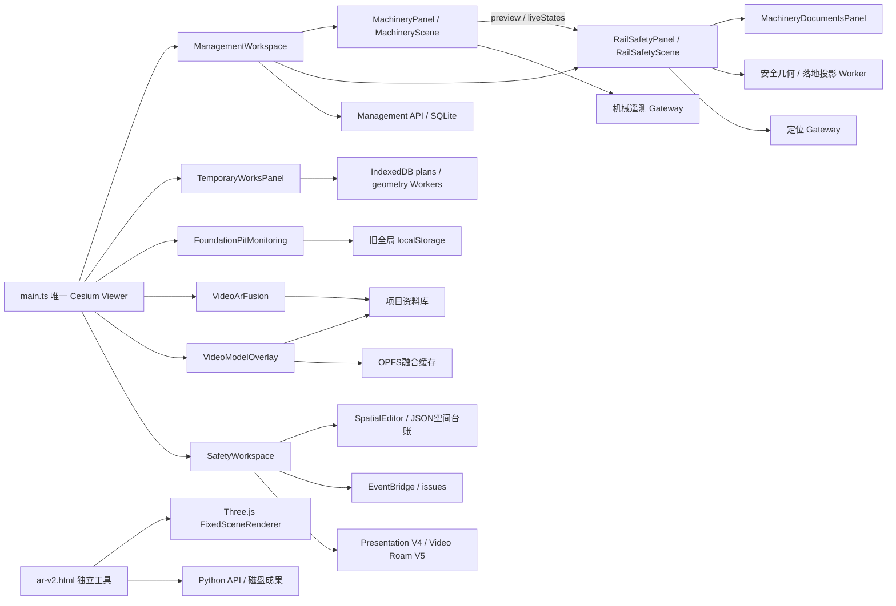

# 第一阶段：施工、安全、监测与巡检专业模块审计

审计基准：`4a5d7c7cdecc31846201d0cf2e0ba7b8d9fc3acc`。独立 worktree：`F:\codex\cesium-platform-management-v2-audit-20261109`。日期：2026-11-09。已阅读根交接文件和 `docs/architecture-v2/` 全部七份设计文档。本文仅新增审计结论，不修改实现、配置、数据或部署。

本文实际检查构造器、入口回调、保存与删除命令、存储、权限条件、数据接入、算法实现及测试断言；没有创建、编辑或删除正式业务对象，没有启动专业数据服务，没有执行专业模块测试或浏览器验收。**“已实现并有测试”仅表示实现和相关测试同时存在，不表示本次测试通过，也不保证每个边界均被测试覆盖。**无真实现场输入/运行证据的设备接入、配准精度、物理安全结论不作验收判断。行号均对应审计基准。

## 1. 核心结论

- 机械身份和三维参数已经共用管理库 `resources`；安全机械配置以 `resourceId` 引用，安全“调整机械尺寸与姿态”回到同一编辑器。安全支承修正是计算专用参数，不能误合并成机械外观参数。
- 专业数据分散：临建 IndexedDB、基坑固定 localStorage、机械运行绑定/姿态历史 localStorage（初始机械模型/姿态在SQLite resources.machinery，管理传感器选择在resources.manageSensors）、视频 OPFS 缓存、AR V2 磁盘产物。只备份 SQLite 与 `management-files` 不足以保护所有数据。
- 基坑实现了矩形多坑、支护、手工/CSV读数、阈值趋势，但业务数据没有项目键。未发现自动监测服务、设备绑定、任意分坑边界、格构柱/放坡、分层开挖/降水动画和专业系统投影的完整实现。
- `managementWorkspace.ts:675-693` 对机械/铁路三维查看及编辑硬编码 `projectId === 'safety:project'`。管理库支持多项目不等于全部专业场景已支持多项目。
- 视频有三条不同链路：Cesium `VideoArFusion`、Cesium `VideoModelOverlay`、独立 `ar-v2.html` 的 Three.js `FixedSceneRenderer`。AR V2 没有第二个 Cesium Viewer，但拥有独立WebGL渲染器和Python产物服务。
- 旧安全工作台四页（总览、无人机巡检、风险管控、构件资料）混合多个权威中心。构件混凝土等级、尺寸、施工状态目前为“未录入”占位，不能当作完整隐蔽工程档案实现。

## 2. 权限与测试索引

下表短码供功能矩阵引用。箭头后是目标六中心菜单，不代表迁移已完成。

| 码 | 当前实际权限/范围 |
|---|---|
| M | 机械/铁路查看：`models` 且项目是 `safety:project`；编辑再需 `resource`；场景需活动。项目/账号/权限撤回重置草稿和实时状态。`src/managementWorkspace.ts:675-693`、`src/machineryPanel.ts:312-338`、`src/railSafetyPanel.ts:378-425`。命令端另有项目/记录范围/修订校验（`server/management/domain.ts:110-149,223-254`）。 |
| MD | 文档查看需models+files；编辑再需resource/field/document/inspect之一，且对象可访问（`managementWorkspace.ts:686-688`、`managementStore.ts:227-235,293`）。 |
| T | 临建宿主采用机械编辑权限再加files；读项目来自workbench状态（`main.ts:1458-1466,3313-3320`）。IndexedDB自身无服务端授权。 |
| P | 基坑类没有独立服务端角色写权限模型；宿主只控制展示范围/目录删除。`foundationPitMonitoring.ts:409-425,483-488,1003,1326`、`main.ts:3304-3310`。显示访问不等于完整业务授权。 |
| V | 主应用media、模型models、CAD/files控制；融合保存走资料库，服务端库写实际需admin（`main.ts:741-746,803-825`、`managementStore.ts:190-197`）。观看/本地编辑与持久保存权限有区别。 |
| S | 空间API先经管理鉴权：读read、写field；任务范围账号不能访问全项目空间目录，模型注册另需models（`managementStore.ts:177-199`）。事件API在238行改由eventBridge接管。 |
| A | AR V2 固定loopback，Origin及命令白名单，未接管理用户/项目角色（`ar_v2/server.py:13-18,98-155`）。视频后端默认loopback WS，MQTT可设认证/TLS，WS未见用户角色校验。 |

测试索引均为现有测试，只读检查，未运行：

| 测试组 | 代表文件及实际断言覆盖 |
|---|---|
| TM | `src/machineryIntegration.test.ts`验证真实目录默认值、模型变形/场景；`machinery/machinery.test.ts`、`machinery/runtimeGeometry.test.ts`、`machineryEditorParameters.test.ts`、`machinerySurfacePicker.test.ts`；`server/management/machineryHttp.test.ts`。 |
| TMT | `src/machineryTelemetry.test.ts`、`machineryTelemetryController.test.ts`（禁用无轮询、旧项目响应、撤权/删除、真实POST模拟器、超时恢复）；`machineryPoseRecorder.test.ts`（来源/时间、配额、分块、导出）；`machineryCaptureSession.test.ts`；`server/management/machineryTelemetryGateway.test.ts`。 |
| TMD | `src/machineryDocuments.test.ts`（精确资源绑定、切换中上传、撤权、清理重试）；`server/management/fileLifecycle.http.test.ts`；`tests/machinery-documents-workspace.test.mjs`调用真实工作区方法，但替代DOM/WebGL，不是浏览器实测。 |
| TR | `src/railSafetyGeometry.test.ts`（真实吊机/支承、相交、中间角度扫掠）、`railSafetyScene.test.ts`、`railSafetyDisplay.test.ts`、`railSafetyEffects.test.ts`、`railSafetyTaskView.test.ts`、`server/management/railSafetyHttp.test.ts`、`railSafetyRisk.test.ts`。 |
| TRF | `src/railSafetyFallDemo.test.ts`、`railSafetyFallDemoGeometry.test.ts`、`railSafetyFallProjection.test.ts`、`railSafetyFallProjectionClient.test.ts`、`railSafetyProjectionRaster.test.ts`、`railSafetyFallProjectionTexture.test.ts`、`railSafetyFallExportProject.test.ts`、`railSafetyPanelFallExport.test.ts`（首帧/取消/最后几何就绪时序）。 |
| TRP | `src/railSafetyPositioning.test.ts`、`railSafetyPositioningClient.test.ts`、`server/management/positioningGateway.test.ts`（精度圈、过期/无数据/重复绑定、模拟不得掩盖实测）。 |
| TT | `src/temporaryWorksLifecycle.test.ts`、`temporaryWorksPositionPanel.test.ts`（原ID/创建时间保留、并发拒绝、迟到响应隔离）、`temporaryWorksGlbLifecycle.test.ts`、InitialElevation/Road/Designed/DrapedRoad/Hardening/Surface/Cad/Clipping同族测试。 |
| TP | `src/foundationPitDisplay.test.ts`使用真实目录/几何/展示方法，绕过完整DOM构造；覆盖显隐和无历史点删除等。没有等量手工录入/CSV导入/写失败提示/真实项目隔离测试。 |
| TS | `src/safetyData.test.ts`、`safetySpatial.test.ts`、`safetySpatialEditorGeometry.test.ts`、`safetyEventData.test.ts`、`safetyScenePresentation.test.ts`、`safetyPresentationRuntime.test.ts`、`safetyVideoRoam.test.ts`；`server/safetySpatialStore.test.ts`、`safetyEventStore.test.ts`、`server/management/eventBridge.http.test.ts`。 |
| TV | `src/videoArCamera*.test.ts`、Surface/Projection/ControlPoints/ControlPointSession/Georeference/Texture/InputProfile同族；`videoOverlayCacheStore.test.ts`验证原字节哈希、事务提交、失败保留和清理重试；`tests/video-overlay-*.mjs`混有源码契约、无WebGL方法测试及浏览器脚本，不能全部称浏览器覆盖。 |
| TA | `ar_v2/tests/test_scene.py`、`test_camera_media.py`、`test_contracts.py`、`test_localization.py`、`test_consensus.py`、`test_validation_identity.py`。包括真实SIFT合成链、原PTS/标定/独立检核身份、丢失不插值、优化成果另存。 |
| TVB | `video_ar_backend/tests/test_backend.py`及DJI提取/SRT/重建测试，覆盖OSD、离线、坐标/时标、限流持久化；不等同当前真实无人机验收。 |

## 3. 施工机械功能归属矩阵

| ID/功能 | 旧入口 → 目标中心/菜单 | 实现与调用证据 | 对象/存储 | 权限/测试 | 实现状态 | 边界/风险 |
|---|---|---|---|---|---|---|
| M01 识别号、名称、种类、新增/保存 | 顶部施工机械、现场工作台 → 施工管理/施工机械 | `machineryPanel.ts:31-39,359-407` → `managementWorkspace.ts:107-112` → `domain.ts:223-238` | SQLite resources.id/equipmentCode/name/machinery/manageSensors | M/TM | 已实现并有测试 | 保存前仅草稿；识别号NFKC/大小写去重（domain:65-70）；没有独立机械主表。 |
| M02 参数联动/比例、角度/姿态、场景取高/放置 | 同上 → 施工管理/机械布置 | `machineryPanel.ts:596-647`、`machinery/engine.ts`、deformation/runtimeGeometry；`machineryScene.ts:181,253,317,452` | resources.machinery；目录原模型；resourceId生成entity | M/TM | 已实现并有测试 | visible/placement仍嵌在业务对象，未独立SceneInstance；实时与手动姿态要分源。 |
| M03 删除机械与仅解除模型 | 机械删除、历史命令 → 施工管理/生命周期 | `managementWorkspace.ts:109`；`domain.ts:230-254`；`machineryScene.ts:130-145,480-488` | delete软删resource/清machinery/停传感器，软删单机railSafety配置，保留历史 | M/TM/TR | 已实现并有测试 | machinery.remove只解除模型；delete不删共享guard/limit或证据原件，不能合并删除语义。 |
| M04 传感器绑定/字段/单位/校验 | 机械传感器管理 → 施工管理/运行监测 | `machineryTelemetryUi.ts` → controller:48-69,105-130,161-199 → telemetry API | 初始模型/姿态在resources.machinery；运行{enabled,config.bindings}按actor/project/resource存localStorage；实时内存 | M/TMT | 已实现并有测试 | 浏览器绑定不是共享TelemetryBinding服务，换设备不自动同步。 |
| M05 实测/模拟接收与状态 | 机械调试、设备POST → 施工管理/运行监测 | controller:224-268；`managementStore.ts:249-259,275-280`；Gateway:72-125 | 进程内frames/cursor/streamId，未改业务revision | M；外部凭据限project/resource/source；TMT | 已实现并有测试 | 重启无完整历史；浏览器模拟明确标源；现场连通待确认。 |
| M06 主动姿态录制/历史筛选/JSON与CSV过程表/清空 | 姿态记录与导出 → 施工管理/运行记录 | `machineryCaptureSession.ts:9-47`、`machineryPoseRecorder.ts:280-398`、HistoryUi | actor/project localStorage，50条分块；resource/code/采集时刻/来源 | 可看活动场景可录制，撤权停止；TMT | 已实现并有测试 | 是主动录制，不是完整服务端遥测历史；满额停止；清空历史独立于机械删除。 |
| M07 性能/合格证/检测报告/报验单上传下载删除 | 点选机械、铁路安全资料 → 施工管理/机械资料，引用项目服务 | `machineryDocuments.ts:3-20,53-109`、Panel:33-76；`railSafetyPanel.ts:1199-1200` | SQLite evidence精确objectRefs=[resources/id]+类别；management-files原件 | MD/TMD | 已实现并有测试 | 不按名称/共同任务模糊匹配；删文件含物理清理，失败可重试；机械删不等于文件删。 |
| M08 安全编辑快捷入口、预览/实时姿态共享 | 安全“调整尺寸姿态” → 施工管理/机械编辑 | `railSafetyPanel.ts:781-795,1362` → workspace:158-160；preview/live回调124-125 | 同一MachineryPanel和resource | M/TM/TR | 已实现并有测试 | 是已存在复用，V2不得再复制一套安全机械尺寸表单。 |

## 4. 营业线安全与人员定位矩阵

| ID/功能 | 旧入口 → 目标中心/菜单 | 实现与调用证据 | 对象/存储 | 权限/测试 | 实现状态 | 边界/风险 |
|---|---|---|---|---|---|---|
| R01 限界多边形/顶点、任务关联、保存/软删 | 邻近营业线/限界；现场定义 → 安全管控/营业线限界 | `railSafetyPanel.ts:477-486,720-778,1402-1428` → railSafety.save/remove | SQLite railSafety.limit，revision/审计 | M/TR | 已实现并有测试 | 绘制不等于被机械选用；完整依据/审批版本模型未发现。 |
| R02 防护站位/责任区/负责机械/工作区/定位器 | 防护人员 → 安全管控/人员防护 | `railSafetyTypes.ts`、Panel:720-778,1064-1110；Scene | railSafety.guard station/polygon/resourceIds/workArea；personnel另有命令 | M/TR/TRP | 已实现并有测试 | 责任区≠定位工作区；设备ID项目内不能重复绑定。 |
| R03 定位实测接入、精度圈、越界/陈旧/无fix | 人员定位状态 → 安全管控/人员防护 | Positioning/Client；Panel:819-853；Gateway:38-76；Store:241-247,282-285 | WGS84+带时区时间+accuracy；进程内最新fix | 设备Bearer独立认证；读models；TRP | 已实现并有测试 | 缺精度/过期/未绑定不报区内；模拟不覆盖实测；无长时定位库。 |
| R04 限界选用/手动报验/支承修正 | 机械安全配置 → 安全管控/机械安全 | Panel:779-817；`domain.ts:120-140` | railSafety.machine(resourceId,selectedLimitIds,inspectionStatus,support) | M/TR | 已实现并有测试 | 报验是手动标记；support只改倒伏支承，不改机械外观；每机械仅一个活跃配置。 |
| R05 倒伏外包/相交/接触/净距/待核实 | 机械分析/风险 → 安全管控/机械安全 | Computation:24-120 → Worker/Geometry；Scene:880-935 | 读取resource姿态/支承/限界，结果签名与草稿/live态；内存结果 | M/TR | 已实现并有测试 | 几何筛查不是稳定性/荷载验算或安全审批；缺有效输入不能判安全。 |
| R06 倾覆动画、角度/方向、落地投影、JSON/视频导出导入 | 倾覆演示 → 安全管控/机械演示 | FallDemo/Projection系列；Panel:855-1063；SceneVideoRecorder | 派生网格/纹理；导出含姿态支承快照，不保存resource姿态 | M/TRF | 已实现并有测试 | 停演示保留原姿态；编码器/GPU当前可用性未实测。 |
| R07 登记风险、去重、任务/整改复核跳转 | 风险卡/处置单 → 安全管控/安全闭环 | Panel:537-566 → reportRisk → `railSafetyRisk.ts:17-83` | SQLite issues.railSafetyRisk，记录resource/config/limit/task修订快照 | models+field/TR | 已实现并有测试 | 未保存live姿态不能登记；未闭环去重；serverRecomputed=false、physicalPrediction=false。 |
| R08 任务筛选/未配机械/处置统计与CSV | 营业线工作视图 → 安全管控/作业风险看板 | `railSafetyTaskView.ts:57-140`、OperationsView:118-199、Panel:488-535 | 从tasks.resourceIds/allocations/railSafety/issues派生 | M/TR | 已实现并有测试 | 列表筛选不收缩安全计算全部授权输入；任务之间机械可重复，数字不可直接累加。 |
| R09 限界墙、区域/外包样式、显隐定位 | 安全显示、场景目录 → 公共目录；安全专业样式 | `railSafetyDisplay.ts:34-136`、Panel:569-688、Scene公开显示方法 | actor/project localStorage样式；显示override | M查看/TR | 已实现并有测试 | 样式、个人显隐、机械选用限界不同层；与SceneDisplayStore并存。 |
| R10 依据审批、自动签认安全结论 | 设计目标 → 安全管控/依据与审批 | definition只存polygon；risk声明不重算/非物理预测 | 无已发现完整审批实体 | — | 未实现 | 不把报验标记、几何筛查、动画描述为现场验收。 |

## 5. 临建设施矩阵

| ID/功能 | 旧入口 → 目标中心/菜单 | 实现与调用证据 | 对象/存储 | 权限/测试 | 实现状态 | 边界/风险 |
|---|---|---|---|---|---|---|
| T01 CAD导入、图层图元/单位、投影/两点配准/复核 | 临建规划参考图 → 施工管理/临建方案，引用工程场景服务 | `temporaryWorksPanel.ts:1270-1735`、Cad/Dxf/Placement模块 | plan.inputs内嵌feature、坐标、配准审计；File与截面附件 | T/TT | 已实现并有测试 | 与顶部CAD是不同专业输入，但文件/坐标配置有交叉；统一资源引用时不能丢审计快照。 |
| T02 标准驻地/钢筋场、CAD场坪/建筑/院落 | 临建驻地/钢筋场 → 施工管理/临建设施 | Panel:2090及run调用；Architecture/Yard/Courtyard/SiteLayout | TemporaryWorksPlan.kind=camp/steel，mesh/buildings/metrics/inputs | T/TT | 已实现并有测试 | 标准参数/材质/标牌/围挡生成器已存在，优先适配。 |
| T03 GLB设施、长宽高、边界适配、logo/亮度 | 临建GLB → 施工管理/临建设施 | Panel:1766-1988；Glb系列、CompanyArtwork/Sign | plan.glb含resourceId；IndexedDB方案；亮度单独localStorage | T/TT、privateTemporaryWorksAssets测试 | 已实现并有测试 | 私有资源是否实际安装待部署环境核验；文件名线索不等于运行可用。 |
| T04 便道设计纵坡/断面/转弯、贴地、土方/预算/分块 | 临建便道 → 施工管理/施工便道 | Panel:1376-1525,1989-2089；DesignedRoad/DrapedRoad/Road、Calculation/Axis/Bends/Conflict/Union/Chunks与Worker | plan.inputs.road、源几何/mesh/metrics | T/TT | 已实现并有测试 | 设计/贴地模式语义不同；保留计算预算/采样缺口；不是通用工序编排。 |
| T05 硬化边界、设施避让、面组合/裁切 | 临建硬化 → 施工管理/场地硬化 | Panel:417-568；HardeningEditor/worker、SurfaceComposition/Plans/Bounds、Clipping | plan.hardening/surface；派生覆盖/裁切内存，源参数IndexedDB | T/TT | 已实现并有测试 | 相邻设施和显隐影响派生占地组合；目录不能绕过依赖刷新。 |
| T06 自动初始取高/手动高程、平移升降 | 临建位置标高 → 施工管理/临建方案 | InitialElevation；Panel:873-954,1858-1882；Position | initialElevation历史来源、positionAdjusted、earthworkDisabled；保留方案ID | T/TT | 已实现并有测试 | 移动不一定重采摄影高程，旧土方不能当新位置现场计算结果。 |
| T07 预览保存、编辑替换、重新打开 | 临建方案列表 → 施工管理/临建方案 | Panel:642-695,2334-2375；Store:7-11,36-60 | IndexedDB `cesium-temporary-works-v1/plans`，[projectId,id]主键 | T/TT | 已实现并有测试 | 替换保留原ID/创建时间/visible，已有防重复；位置更新有原快照比对，非统一服务端revision。 |
| T08 显隐/定位/检查、删除方案 | 临建列表/场景目录 → 公共目录+施工生命周期 | Panel:729-759,2377-2398；Store:64-65 | setPlanVisible仅override；内部changePlanVisibility会写新plan.visible；remove硬删行再销毁handle | T/TT | 已实现并有测试 | 两入口显隐副作用不同；无软归档/回收站；不删共享GLB原件。 |
| T09 草稿保护、跨用户同步/版本/归档 | 设计目标 → 施工管理/方案生命周期 | close:617-624、setProject:642-678直接清预览；Store无角色/版本历史 | 无共享方案服务或修订历史 | T | 部分实现 | 异步取消/迟到隔离存在；统一离开草稿保护、共享修订归档尚未完成。 |

## 6. 基坑与智能监测矩阵

| ID/功能 | 旧入口 → 目标中心/菜单 | 实现与调用证据 | 对象/存储 | 权限/测试 | 实现状态 | 边界/风险 |
|---|---|---|---|---|---|---|
| P01 多坑列表/中心取点、长宽深/朝向、抬高/比例展示 | 顶部基坑监测 → 智能监测/基坑管理 | `foundationPitMonitoring.ts:58-85,679-739,1003-1069,1513-1591` | 全局state.pits；固定localStorage key（193、741-752） | P/TP部分覆盖 | 已实现并有测试 | 多矩形坑≠任意分坑多边形；显示offset/scale不是工程坐标；state无projectId。 |
| P02 钢板桩/咬合桩/地连墙、围檩、管/H钢/混凝土支撑、多层/手选支撑 | 基坑支护 → 智能监测/支护建模 | 同文件:196-203,1223-1265,1561-1806 | enclosure/waler/strut/supportDepths/customSupports | P/TP几何显示覆盖 | 已实现并有测试 | 展示模型≠结构验算；没有格构柱/放坡专业功能。 |
| P03 位移/沉降/自由点、支撑轴力变形点、阈值 | 基坑点位 → 智能监测/监测点 | 同文件:97-138,1202-1222,1281-1325,1355-1380 | points.pitId、supportMonitors.pitId/targetId +嵌套records | P/TP目录覆盖 | 已实现并有测试 | 无硬件设备ID/协议绑定；不是自动设备台账。 |
| P04 手工日报/同时间替换、趋势/速率/阈值/变形展示 | 基坑数据预警 → 智能监测/数据分析 | 同文件:1326-1352,1382-1436,1937-1981,2131-2179 | 本地records内嵌；ISO时间；同时间原位覆盖 | P/TP未覆盖完整录入 | 已实现但缺少测试 | 无数据为unmeasured（1411、1420）；无设备质量/迟到/陈旧状态；同时间可覆盖，没有不可变历史保护。 |
| P05 CSV日报导入/导出、JSON备份下载 | 基坑导入导出 → 智能监测/数据管理 | 同文件:2234-2345 | CSV按ID或名称匹配现有点，同时间覆盖；JSON完整state | P/未发现完整导入导出专项测试 | 已实现但缺少测试 | 名称匹配不等于稳定ID；下载不等于服务端备份；未确认JSON反向恢复入口。 |
| P06 显隐、目录点删除、完整坑/点删除 | 场景显示/坑点列表 → 公共目录+智能监测生命周期 | 同文件:440-488,894-901,1071-1085,1925-1936,2014-2023 | 目录只删无历史点；面板可确认后硬删坑/子点/支撑/读数 | P/TP、业务删除回归脚本 | 已实现并有测试 | 无归档回收站；目录不能升级为无差别完整删除。 |
| P07 自动回传、专业系统跳转/投影 | 设计目标 → 智能监测/数据接入与联动 | 类无fetch/WebSocket/设备订阅，只有手动/CSV | 无已发现自动样本服务 | — | 未实现 | 机械/人员Gateway不能当作基坑监测接口。 |
| P08 任意分坑、格构柱/放坡、分层开挖/降水/工序动画导出 | 设计需求 → 智能监测/施工过程 | Pit仅length/width/depth；1561后静态开挖面，无工序播放器 | 无已发现过程实体 | — | 未实现 | 静态开挖面、机械倾覆动画都不是基坑施工动画。 |
| P09 项目/用户隔离、权限、监测服务权威数据 | 设计目标 → 智能监测公共上下文 | 同文件:134-138,193,482-488,741-752 | 全局state；displayScope只重置override | P | 部分实现 | 有显示范围撤回，无业务分项目；不能仅换UI就声称多项目不串数据。 |

**保存结果不一致风险已由代码确认：** `saveState()`（885-890）捕获localStorage写失败后仅toast，不返回失败。`addRecord()`（1343-1352）已改内存，调用saveState后仍提示“日报已保存”；CSV导入（2263-2270）同样继续提示成功。当前画面可能有记录，刷新后丢失，而用户已收到成功消息。删除反而使用 `commitDeletion()`（894-901）先保存成功再更新内存。此处仅记录，未触发任何业务写入。

## 7. 旧安全工作台、空间定义及V3/V4/V5表现

| ID/功能 | 旧入口 → 目标中心/菜单 | 实现与调用证据 | 对象/存储 | 权限/测试 | 实现状态 | 边界/风险 |
|---|---|---|---|---|---|---|
| S01 总览层级/CAD锚点/区段推定/统计图层时间过滤 | 安全大屏总览 → 项目管理/驾驶舱；场景表现归工程场景 | `safetyWorkspace.ts:109-176,372-420`、`safetyData.ts:121-174,265-337`、DashboardV3:110-145 | 只读库CAD/视频，派生Dataset/内存Store | S及models/files/media；TS | 已实现并有测试 | 逻辑盖梁/墩柱/承台不是正式BIM；生产不种demo事件/任务。 |
| S02 施工区/铁路区/风险点绘制、拖点/撤销重做/草稿保护 | 安全/现场定义 → 施工区归施工管理；铁路/风险归安全管控 | `safetySpatialEditor.ts:130-156,169-225,234-408` → repository/API | safety-spatial.json；对象/快照revision、mutationId、模型/变换版本/顶点来源；软删恢复 | S/TS | 已实现并有测试 | 与RailSafety.limit/guard不是同一几何；风险点不是事件；施工区不是临建方案。 |
| S03 事件筛选处理、管理问题投影、旧事件兼容 | 风险管控/处理结果 → 安全管控/安全闭环 | Workspace:235-245,735-741；EventRepository:13-49；`managementStore.ts:238`→eventBridge | 当前SQLite issues投影；历史safety-events.json；三态徽章不是权威issue状态 | bridge/issue权限；TS | 已实现并有测试 | 管理宿主处理转开issue，不再新建第二套整改状态；旧Store文件不等于生产写入口。 |
| S04 墩位/构件搜索、施工图查看下载、CAD区域预览 | 构件资料（隐蔽档案线索） → 项目管理/资料协同，场景归工程场景 | DashboardV3:192-207；DrawingViewer:44-65；CadPreview:6-44 | 项目原件引用、CAD实体索引、逻辑节点 | files/models；TS部分 | 部分实现 | 没有完整构件专属图纸索引和BIM唯一ID绑定。 |
| S05 混凝土等级/尺寸/施工状态、隐蔽验收档案闭环 | 构件详情 → 项目管理/构件与验收资料 | `safetyDashboardV3.ts:205`固定“未录入”，无该页面写表单 | 无已发现此专业字段记录 | — | 仅有 UI | 通用检查验收存在不等于该构件档案入口已实现。 |
| S06 录像选择/播放倍速/时间轴/轨迹相机跟随 | 大屏无人机巡检 → 智能巡检/回放 | Workspace:477-669；VideoRoam；`presentationV5/video-roam.js:14-104,242-291` | 复用video元素、源媒体ID/轨迹，内存绑定 | media/models；TS | 已实现并有测试 | path仅轨迹跟随；camera仅位置姿态，不是光学配准；缺姿态拒绝camera，断档不造点。 |
| S07 实景/展示、裁切材质/底座、流动/脉冲效果 | 展示/实景/总览 → 工程场景/表现工具，安全快捷引用 | ScenePresentation:28-100 → V4 install:22-100 → scene-presentation/effects | 现有Viewer/tileset；只管自有材质裁切primitive，无业务写库 | models；TS | 已实现并有测试 | WeakMap防同Viewer重复安装；显示包络不是施工红线；需核验模型版本。 |
| S08 旧SafetyDashboard类 | safetyDashboard.ts存量 → 兼容代码评估 | Workspace:21实际import safetyDashboardV3，V3加载V5 CSS；搜索未发现src生产导入旧类 | 内存UI | 旧工具存在 | 历史兼容 | 不为历史文件制造新菜单；删除另阶段验证。 |
| S09 正式构件总数/在建数量 | V3总览指标 → 项目管理/指标 | DashboardV3:122-123只有模型绑定才计数，在建固定未接入 | 无完整正式构件来源 | — | 仅有 UI | 不能填造统计数。 |

**演示与真实链路：** `safetyData.ts:234`导出createSafetyDemoDataset，实际调用主要在测试。生产LocalSafetyDataAdapter在321-337明确不补示例区段、告警、任务。CAD逻辑墩组/构件有derived/来源说明，真实文字插入点也不是复核桩心。V4只变显示，V5只耦合现有视频与相机，不写业务；都不证明现场设备在线、正式巡检任务或隐蔽验收已接通。

## 8. 视频AR、融合、独立AR V2及后端矩阵

| ID/功能 | 旧入口 → 目标中心/菜单 | 实现与调用证据 | 对象/存储 | 权限/测试 | 实现状态 | 边界/风险 |
|---|---|---|---|---|---|---|
| V01 视频/轨迹/ZIP、DJI独立视频姿态、同步回放 | 顶部视频AR回放 → 智能巡检/视频AR | `videoArFusion.ts:1217,1709-2334,2524-2725` | SavedReplay/files与库Drone Video；flight points/帧身份内存 | V/TV、TVB | 已实现并有测试 | 源身份/时间/相机/高程不能按文件名猜；不兼容保持错误。 |
| V02 相机标定/控制点/地理配准、投影网格/模型表面融合 | 视频AR投影校核 → 智能巡检/视频配准 | Fusion:1409-1450,1916-2001,2909-3556；Camera/ControlPoints/Georeference/Surface/ModelProjector | session/controls与源身份，回放settings；GPU纹理/mesh临时 | V/TV | 已实现并有测试 | 实际项目精度未验收；无交点不补满，纹理与几何帧身份需保留。 |
| V03 状态/视频双WS、实时姿态队列/帧同步/断开 | 视频AR实时 → 智能巡检/实时视频 | Fusion:4310-4864 | 浏览器帧/pose队列；后端video_cache/trajectory | V/A；TV/TVB | 已实现并有测试 | 真实设备/流地址/时钟/运行状态待确认，代码不代表已连接。 |
| V04 画质/GPU上传/性能FPS/纹理证据/诊断 | AR诊断、工作台视频诊断 → 智能巡检/视频诊断 | Fusion:955-1137,3835-4100；TextureFrame/Quality/Performance | 内存指标、导出JSON/图片；回放控制可存 | V/TV | 已实现并有测试 | 计数或截图不能独自证明光学配准正确；当前GPU未验收。 |
| V05 CC空三XML/POS/抽帧清单、原片身份/时间/相机修正 | 视频AR的CC融合 → 智能巡检/视频融合 | `videoModelOverlay.ts:55-98,418-458,596-653,923-981`；cc camera/track、FrameManifest | source/video/pos/manifest + SavedVideoOverlaySettings | V/TV及CC测试工具 | 已实现并有测试 | 与V01输入协议不同，不能仅换名合并解析器；导入新清单会重置方案输入。 |
| V06 CAD/模型选择、单体/整体位置朝向倾角、拖拽/撤销、遮挡/摄影参照 | CC对象编辑 → 智能巡检/融合编辑；原件归工程场景 | Overlay:458-560,1152-1296；Resources/Adjustment/Occlusion | 方案selectedIds、adjustments/group、sceneReference/occlusion | V/TV及drag/cache/occlusion测试 | 已实现并有测试 | 方案偏移不能回写全局工程transform；原件不可访问时阻止破坏性保存。 |
| V07 时段标注/效果/空间标注、方案保存/自动保存/恢复 | CC标注与方案 → 智能巡检/巡检成果 | Overlay:118-120,217-234,1297-1375；`main.ts:803-833` | 资料库Drone Video/settings.video与原件；按session/revision提交；失败重用ID | V；写库admin；TV/自动保存测试 | 已实现并有测试 | 已有离开自动保存，统一面板需要兼容；可看录像不等于可持久写方案。 |
| V08 抽帧、完整融合缓存、原分辨率/PTS视频与音轨导出 | CC缓存/导出 → 智能巡检/成果导出 | Overlay:942-1130；CacheStore:22-85；Exporter/FrameExporter | OPFS `cesium-ar-fused-movies-v1`，schemeId/内容哈希/源时标；本机视频 | V/TV缓存测试及浏览器脚本 | 已实现并有测试 | 依赖WebCodecs/OPFS/磁盘，manifest完整提交后才播放；缓存与原件分开。 |
| V09 退出/撤权/删除时decoder/纹理/render targets清理与缓存重试 | 方案删除、切换面板 → 智能巡检生命周期 | Overlay:1437-1521；main:780-795；Fusion:1498-1595,4864 | 临时GPU/Blob/Worker释放；scheme缓存清理；原件由库层 | V/TV及deletion/access回归 | 已实现并有测试 | 目录刷新不得重建视频；卸载/销毁与删除库记录不同。 |
| A01 固定网格准备/模型检查、原PTS抽帧/相机profile | ar-v2.html/CLI → 智能巡检/定位融合高级工具 | `ar_v2/__main__.py:13-49`、`scene.py:445`、`media.py:51,211,298` | YAML输入；默认output/ar-v2/scene、media、resolved-config；原输入引用 | A/TA | 已实现并有测试 | 不共享主库projectId/账号，不是主Cesium场景实例。 |
| A02 参考RGB/深度/三角ID、SIFT/ALIKED-LightGlue、PnP/跟踪/优化 | AR V2任务 → 智能巡检/自动定位 | `references.py:22-49`；`localization.py:61,100,164,332,452,582,707` | localization/tracking/refinement下pose/匹配/overlay；geometry/profile/video/PTS身份 | A/TA | 已实现并有测试 | 权重/外部依赖/真实输入未实测；丢失/退化不能当已定位。参考渲染由tools/ar-v2-render.mjs临时Vite访问`/ar_v2/reference.html`。 |
| A03 独立检核/源身份、结果查看与网格精确投影 | AR V2验收结果 → 智能巡检/定位校验 | `validation.py:72,116,210,238`；`web/renderer.ts:1,62-94`；viewer:18-91 | geometry_version/source_video_hash/frame_id/PTS/time_base/profile/calibration；Three.js浮点targets | A/TA | 已实现并有测试 | 独立检核需完整分母与身份；没有本次真实项目验收结果。 |
| A04 本地API/任务队列/取消/产物HTTP | AR V2 GUI/serve → 智能巡检/高级任务 | server:43-155 GET status/poses/frame/artifacts，POST jobs/cancel | jobs/status.json+run.log，单活跃任务 | A；service-smoke工具存在 | 已实现并有测试 | Origin限制不是身份认证，无Origin本地请求可发命令；无多租户授权。 |
| B01 MQTT OSD/云台、RTMP采集、双WS、航迹/帧/ZIP | video_ar_backend/start.py与cmd → 智能巡检/数据接入 | backend_v1/main.py:54-100,195-394；mqtt_client/video_processor/websocket/packager | DRONE_DATA_DIR，默认backend/data下video_cache/trajectory/logs | A/TVB | 已实现并有测试 | 需真实SN/broker/流地址，WS不接管理权限；不能当统一认证API直接暴露。 |
| B02 DJI元数据/SRT、COLMAP投影重建 | 视频提取独立工具/cmd → 智能巡检/预处理 | dji_video_extractor/dji_srt_extractor；projection_reconstruction:212,280,330,672 | 原片派生SRT/轨迹/帧/投影JSON/重建目录 | 本地工具/TVB | 已实现并有测试 | 依赖FFmpeg/COLMAP/有效源，未验收现场输出。 |
| V10 统一任务-航迹-媒体-标定-证据关系、专业巡检报告 | 设计目标 → 智能巡检/任务与报告 | 管理issues/evidence有引用；AR方案无统一inspectionTaskId贯穿各链 | 尚无单一跨AR链路关系对象 | 既有管理权限需适配 | 部分实现 | 视频/JSON/CSV/截图导出不能笼统称为完整巡检成果报告。 |
| V11 当前无人机/定位器/机械传感器现场链路 | 本机运行环境 → 各中心接入 | 本文只有实现及测试证据，未触发设备 | 实际连接/时钟/质量需运行证据 | — | 待确认 | 当前服务是否运行由环境报告汇总，单有能力代码不代表已接通。 |

## 9. 真实存储、对象关系与生命周期

| 对象/关系 | 权威写入者与存储 | 当前生命周期及适配要求 |
|---|---|---|
| 机械resource→machinery→railSafety machine | 管理命令/SQLite records；resourceId稳定关联 | Scene按resource ID生成，preview/live不自动保存；delete软删resource与单机配置。保留resource.*通用业务与machinery.*模型职责，不建第二identity表。 |
| 机械文件→evidence.objectRefs | 管理资料API/SQLite evidence + management-files | 精确对象绑定；删文件受修订/清理状态控制；其他中心仅引用，不按名称重新上传。 |
| 绑定/遥测/录制历史 | SQLite保留初始机械姿态与manageSensors选择；localStorage保留运行字段绑定/启停；Gateway进程缓存；浏览器分块历史 | live同时供机械显示和安全；切换/撤权停止。未来迁移保留manual/measured/simulated及真实采集时间，不能当完整历史。 |
| 限界/责任区/工作区/风险 | SQLite railSafety；最新定位内存；issues风险快照 | 各几何不同语义，保留来源版本与计算时间；筛查结果不自动验收。 |
| 临建方案→模型/CAD/mesh | IndexedDB plans[projectId,id]；亮度/开关localStorage | 关闭清预览，编辑保ID；删除硬删方案再卸scene。归档/备份改造前不换源清空。 |
| 基坑→点/支撑点→读数 | 固定key localStorage嵌套records | 全坑删除级联硬删历史；目录仅无历史点快删。先确认旧数据归属/备份/迁移回滚，不自行猜projectId。 |
| 人工空间定义→任务/问题引用 | safety-spatial.json；模型/变换/顶点来源，管理命令核验引用 | 软删/恢复，risk-point不是事件。不得覆盖railSafety限界、展示包络或临建占地。 |
| 旧安全事件→issue投影 | eventBridge接管API；SQLite issues；历史JSON兼容 | 三态徽章只是投影，处置回到issue服务，不再维护第二完成状态。 |
| 视频原件/回放/CC方案/校核 | 项目资料库record/files/settings；OPFS仅缓存 | exit清临时GPU/decoder，方案删除清对应缓存，原件库层控制；三条AR专业合同需保留。 |
| AR V2任务/规范化几何/定位 | YAML+output/ar-v2，jobs JSON/pose artifacts | Three.js固定geometryVersion，自有renderer；先保留独立URL，嵌入另设计身份/GPU生命周期。 |

## 10. 重复入口、重复配置与不可误合并对象

| 项目 | 当前证据 | 目标裁决 |
|---|---|---|
| 机械编辑 | 顶部、管理资源表、铁路调整、现场场景；workspace:107-160 | 已共享专业编辑器/resource；统一注册入口，保留跨中心快捷引用。通用资源表仍可改名称/识别号，应明确字段权威表单。 |
| 机械资料 | 点机械、铁路资料子页、项目证据/资料页 | 复用同一Panel/evidence；施工中心权威业务入口、项目服务保存、安全引用。 |
| 外观尺寸与安全支承 | machinery.parameters vs railSafety.machine.support；Panel:790-795 | 后者仅倒伏支承估计，不能覆盖外观；记录用途/来源/版本。 |
| 三种铁路区域 | safetySpatial.railway、railSafety.limit、displayEnvelope | 分别人工参考区域、机械选用限界、展示包络；不能按polygon类型合并。 |
| 风险点/事件/issue/筛查快照 | spatial risk-point、旧event、issues、railSafetyRisk | 定义/发生/处理/证据不同；稳定ID关联，不相互自动制造事件。 |
| 临建显隐 | changePlanVisibility写visible，setPlanVisible只override | 统一目录前区分业务默认和个人偏好，保留旧数据读兼容。 |
| CAD/坐标参数 | 工程CAD、临建配准投影、视频空三参照、安全CAD适配 | 复用资源/坐标服务，但专业输入和方案修正不同版本，不只保存最后一个transform。 |
| 监测点/设备 | 基坑点、机械binding、guard.deviceId、管理监测记录 | 当前没有统一TelemetryBinding；名字相似不表示同设备，先建立稳定来源关系。 |
| 视频三链+大屏回放 | Fusion投影、CC叠加、AR V2定位、安全回放 | 统一导航而非合并不同解析/渲染器；大屏复用已有video，保留独立URL。 |
| 多种视频位置修正 | 全局model matrix、CC cameraRegistration、object/group调整、sceneReference | 作用域不同；视频方案不得改原始工程坐标；缓存签名需保留所有相关版本。 |
| 安全V3/V4/V5命名 | V3 UI加载V5 CSS，表现用V4安装器，V5 video-roam实际运行 | 按import链评估，不能当作三个业务中心；旧safetyDashboard.ts可达性另确认。 |
| 基坑删除入口 | 目录无历史点快删，面板坑/点可含全部日报 | 统一名称不等于统一影响；必须保留历史保护/影响提示。 |

## 11. 依赖与Viewer所有权

专业类消费传入Viewer：`MachineryPanelOptions.viewer`（33）、`MachineryScene`构造器（104）、`RailSafetyPanelOptions`、`TemporaryWorksPanelOptions`、`FoundationPitMonitoring`构造器（409）、`VideoModelOverlay`构造器（239）、`SafetyScenePresentation`构造器（61）。Worker不创建Viewer。`presentationV4/install-presentation.js:5,31-34,83-100`对现有Viewer防重复安装；`presentationV5/video-roam.js:24-33,100`复用Viewer/video。`ar_v2/web/renderer.ts:1,62-80`是Three.js，不违反主页面单Cesium Viewer，但有独立GPU资源生命周期。

需要保留的释放路径：机械Scene.destroy（286、480）清实体/Blob；铁路Panel.dispose（440）取消演示/导出/定位；临建destroy（626-639）中止监听/Worker/预览/mesh；基坑dispose（427-436）移除dataSource/primitives；视频退出（Overlay:1437-1521、Fusion:1498-1595）释放decoder/frame callback/render target/Blob；安全Workspace.dispose（786后）关闭订阅/界面/表现/空间编辑。统一面板隐藏不得直接绑定业务对象删除。

## 12. 风险与后续顺序建议

以下仅为审计结论，不构成第二阶段授权。本阶段不修复。

| 编号/级别 | 风险/触发条件 | 证据 | 后续建议 |
|---|---|---|---|
| PR-01 高 | 基坑旧数据全局，切displayScope未分业务项目 | Pit:134-138,193,482-488,741-752 | 先备份并确认归属，再迁移兼容/回滚，不猜项目。 |
| PR-02 高 | 基坑写失败仍提示保存成功 | Pit:885-890,1343-1352,2263-2270 | 后续提交成功才改状态/成功提示，补配额失败测试。 |
| PR-03 高 | 临建/基坑硬删与目标默认归档冲突 | Pit:1071-1080,2014-2023；Store:64-65 | 先明确影响，新增归档需迁移方案，禁止清旧存储。 |
| PR-04 高 | 专业三维只支持safety:project | Workspace:675-693；main:3314 | 先设计上下文/权限/订阅切换，不直接删硬编码后宣称多项目支持。 |
| PR-05 中 | 临建关闭/切项目直接丢预览草稿 | Panel:617-624,642-678 | 导航适配加明确草稿决策，保留取消/资源释放。 |
| PR-06 中 | 临建显隐两种存储副作用 | Panel:729-756 | 区分业务默认与用户override，兼容已有数据。 |
| PR-07 高 | 浏览器本地方案/读数/绑定/历史/缓存不在SQLite备份内 | 第9节 | 明确origin/profile保护与导出，禁止将清浏览器存储作为普通清缓存。 |
| PR-08 中 | Gateway样本仅进程内，现场链路未验收 | TelemetryGateway:72；PositioningGateway:38 | 保留时间/质量/断连提示，区分主动录制和完整后端历史。 |
| PR-09 高 | 几何/动画/手动报验可能误当物理预测/审批 | Risk:67；Panel:786-795 | 保留筛查/手动/待核查语义，不能自动判定验收。 |
| PR-10 中 | 铁路参考区/限界/显示包络相似但不等价 | SpatialTypes、RailSafetyTypes、ProjectDisplayConfiguration | 稳定ID关联与权威编辑，不自动覆盖。 |
| PR-11 中 | 独立AR/旧视频后端未接管理账号项目权限 | AR server:98-155；WS handle_client | 保留本地工具边界，统一入口前设计身份，不能直接公网暴露。 |
| PR-12 中 | media可读与admin可保存能力不一致 | main:805；Store:197 | 区分view/edit/export，拒绝时保持草稿，避免误报已保存。 |
| PR-13 中 | 多模块操纵同一camera/material/clipping/video，重建/隐藏易干扰 | V4所有权、Overlay captureScene/exit、临建interaction suspension | 复用现有适配器/互斥交互，验证进入/退出/取消。 |
| PR-14 中 | 测试层级混合；现场/GPU/实际精度未本次验证 | 第2节及验收工具 | 分单元/方法/源码契约/浏览器/现场证据，不能以脚本存在代替通过。 |

建议后续先设计草稿/上下文/权限适配及数据备份边界，再统一专业入口与面板，接着统一目录生命周期，最后经单独批准迁移数据与长期样本/关系。真实监测、构件专属档案、基坑施工动画是缺失能力建设，不应混入“只换入口”的第二阶段。

## 13. 设计文档事实修正

- 功能总清单的基坑应明确“矩形多坑、三类围护、围檩/多层与自定义支撑、手工/CSV位移沉降轴力、本地阈值趋势”；格构柱/放坡/分层开挖/降水/动画/专业服务联动未实现。
- 机械权威记录已为SQLite resources；RailSafety已有回到机械编辑器的快捷路径，基础参数不要再建第二主表。
- 面板契约应考虑临建关闭清草稿、CC离开自动保存两种既有行为，不能称所有专业面板已经遵从统一合同。
- 数据边界补上基坑固定localStorage、机械运行绑定/分块历史、专业样式、临建亮度/开关、OPFS、AR V2产物、旧安全JSON/事件bridge。SQLite+management-files备份覆盖不全。
- 生命周期目前机械已有软删与解绑，临建/基坑仍硬删，目录与面板删除能力不同。“默认归档”是目标而非当前事实。
- 单Viewer规则针对主Cesium宿主；独立AR V2是Three.js工具，应保留URL后评估集成，不能据此强制改写渲染器。
- 巡检专业报告不能笼统标已完成；确认产物为视频、诊断/姿态JSON、CSV、截图证据及管理问题关联，全部任务贯穿/专业报告仍部分实现。
- 旧安全构件资料需区分CAD真实文字锚点与逻辑构件：BIM唯一ID和该页混凝土/尺寸/状态编辑未接入，正确显示“未录入”。本结论不否定仓库其他隐蔽档案/资料模块及其测试，完整范围见工程入口审计。
- 场景质量优化的检查/对照已有实现，但候选生成/验证/激活/回滚当前返回409，应保持部分实现口径，不能算自动修复已交付；该能力详见工程入口审计。

## 14. 验收工具与边界

仓库存在 `tools/verify-machinery-{platform,runtime,workbench,telemetry,documents,live-export,config-history,appearance-heading}.mjs`、`verify-rail-safety*.mjs`、`verify-temporary-works*.mjs`、`run-temporary-works-regression.mjs`、`verify-video-ar*.cjs`、`verify-cc-video*.mjs`、`verify-video-overlay*.mjs`、`verify-safety-dashboard*.cjs`、`audit-platform-v5-video-roam.mjs`、`ar-v2-smoke.mjs`、`ar-v2-service-smoke.mjs`。工具可能启动服务、创建fixture、写缓存/报告或操作测试数据；本次只读盘点/检查相关断言，没有执行。

本文未读取或输出服务密钥、设备凭据、业务库内容、浏览器私有业务数据或原媒体，因此不宣称设备当前连通、私有GLB已安装、真实读数正确、现场安全已验收或AR精度通过。部署版本、运行服务与主工作区保护由本阶段环境/总报告汇总。本文简称的TS文件默认位于src/，服务端文件位于server/，Python/web路径明确标ar_v2或video_ar_backend。
