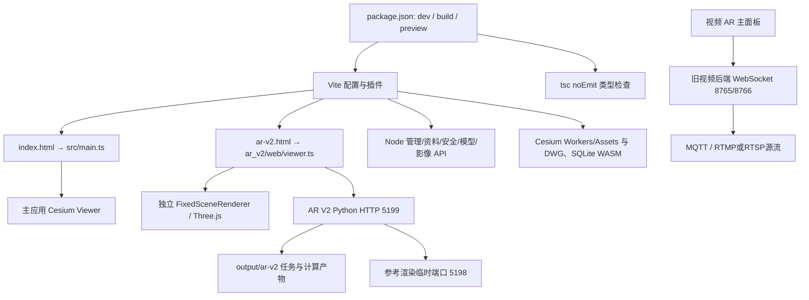

# 05 测试、依赖、构建与部署边界审计

审计日期：2026-11-09。源码快照：`4a5d7c7cdecc31846201d0cf2e0ba7b8d9fc3acc`，独立目录 `F:\codex\cesium-platform-management-v2-audit-20261109`。本文件仅报告第一阶段发现；未安装依赖，未构建，未启动或停止服务，未执行测试、部署或数据迁移。

## 1. 全仓覆盖范围和证据口径

已按 `git ls-tree -r --name-only HEAD` 枚举 **1090 个受版本控制文件**；逐文件读取并生成 SHA-256、大小、类别、文本行数、直接导入、局部 URL 和副作用线索。951 个文本文件共 179193 个分行计数（包含尾部空行），139 个二进制文件仅检查路径、大小与哈希，未解码图像、视频、字体或网格。

对应附件：

- [repository-file-inventory.tsv](repository-file-inventory.tsv)：1090 条，一文件一行；记录每个文件的实际检查方式。
- [test-inventory.tsv](test-inventory.tsv)：328 条测试、验收及诊断脚本映射；包括依赖、目标线索、隔离证据、潜在副作用及可提取的测试名称。全部执行状态均为“未执行”。

“全文机器扫描”表示读取文本后扫描导入、路径、测试和副作用特征，**不等于逐行语义审查或安全验证**。关键构建、启动、服务入口和代表性测试另行读取控制流。`center_hint_not_authoritative` 是检索辅助字段，按文件线索归类；真正功能归属以本审计的功能矩阵为准，不据此判定实现状态。直接导入字段采用词法提取，可能包括测试内嵌打包字符串，不等同完整运行依赖图；动态反射、运行时注册和跨进程协议需结合其他分报告。

| 顶级目录 | 受控文件数 | 覆盖方式与重要关系 |
|---|---:|---|
| src | 439 | 前端业务、Worker、样式、类型和146个 Node 测试；主应用和专业模块关系见入口/业务报告 |
| tools | 195 | 运维、转换、浏览器验收、诊断、独立资产构建和夹具；绝不可按 tools 名称视为只读 |
| docs | 151 | 设计、历史验收记录与图像；设计文档7份已阅读，历史“通过”不作为本次执行结果 |
| public | 127 | 静态数据/资源/字体；私有临建设施模型另受忽略规则保护 |
| server | 43 | Node服务与20个 Node 测试；主要由 Vite 插件链提供 API |
| ar_v2 | 38 | 独立 Python 计算服务、Three.js 前端、6个 Python 测试文件 |
| video_ar_backend | 36 | MQTT/视频/WebSocket采集、独立GUI与重建工具、5个 Python 测试文件 |
| tests | 28 | 14个 Node test 文件，另14个独立回归/浏览器脚本 |
| 验收记录 | 2 | 历史JSON记录；非本次重新验收 |
| 根目录文件 | 31 | HTML、构建/依赖、版本、启动器和交接 |
| 合计 | 1090 | 与覆盖表行数一致；不包括本次新增审计报告 |

139 个二进制包括 101 个 woff2、23 个 png、11 个 bin、4 个 mp4。非受控 `.env`、数据库、原始媒体、缓存和私有SDK不属于1090文件清单；本机部署身份和目录另见部署核查报告。未遍历或读取业务库内容来补造数据结论。

## 2. 真实构建和服务拓扑

证据：

- `package.json:10-14` 只有 `dev`、`build`、`preview`；`build` 为 `tsc && vite build`，没有统一 `test`、`lint` 或覆盖率命令；未声明 `engines`、`packageManager`。`dev`/`preview` 默认 `--host 0.0.0.0`，启动脚本另指定 loopback；直接运行包脚本和运行启动器的网络边界不同。
- `tsconfig.json:13-18` 为 strict/noEmit，显式 include 为 `src`、`ar_v2/web`、`vite.config.ts`。由这些文件导入的服务模块参与类型解析；不能据此认为 `server/**/*.test.ts`、tools 和 Python 全部经过构建检查。
- `vite.config.ts:554` 的生产 HTML 输入是 `index.html` 与 `ar-v2.html`；测试/参考 HTML 不能因源码可经 dev server 打开就视为生产包入口。
- `vite.config.ts:563-580` 依次装配 management、safetySpatial、modelOptimization、safetyEvent、projectLibrary、basemap/diagnostics、localImagery、engineeringModels、localTiles，并复制 Cesium 静态文件、libredwg WASM、sql.js WASM。
- `server/managementStore.ts:2,56,63,307` 引用 `node:sqlite`，初始化数据库并由 `configureServer`/`configurePreviewServer` 挂载。因此 `dist/` 纯静态托管不足以提供现有管理/资料能力。`vite.config.ts:395-396` 在配置加载时即创建 `.basemap-cache` 和 `.render-errors`，运行 build/dev 本身不是只读操作。
- `tools/test-module-loader.mjs:2-20` 使用 Node `registerHooks` 兼容 `src` 的无扩展名 TS、JSON 导入。部分测试还调用 esbuild 到临时目录，再导入真实模块；不能统一等同无文件写入的纯计算单测。

### 运行依赖与可复现性

| 组件 | 声明/锁定情况 | 审计结论 |
|---|---|---|
| Node主应用 | README、`tools/start-cesium.ps1:14-30` 要求 Node24+，探测 `node:sqlite`；依赖包本身未声明 engines | 运行合同存在，但不是仅看 package.json 可发现；所有启动入口需统一验证 |
| 前端核心 | Cesium1.144.0、Three0.180.0、ECharts6.1.0、MediaBunny1.61.6、Koffi3.3.2、proj4、GeoTIFF、polygon-clipping、sql.js、libredwg | 部分精确固定，部分 semver 范围；本次未变更或安装 |
| 构建工具 | TypeScript、Vite、esbuild、vite-plugin-static-copy | `tsc` 与 Vite 是两个检查环节；无当前执行证明 |
| Playwright | 大量验收脚本读取 `PLAYWRIGHT_MODULE`、Codex runtime 路径或用户绝对路径；根 package.json 未声明 | 浏览器验收不是从仓库安装依赖后天然可复现；需配置浏览器、GPU和外部运行库 |
| AR V2 | `ar_v2/requirements.txt` 固定核心版本；另有 Windows CPython3.12完整锁、LightGlue Git提交及权重锁 | 独立 Python/CUDA/FFmpeg/WebGL2 流程；默认 CUDA，机器缺依赖不能推断功能未实现 |
| 旧视频后端 | `requirements.txt` 范围依赖与 `requirements.initial.txt` 历史精确清单并存 | 当前推荐安装与历史备份环境不必相同；不是一个可与AR V2直接合并的Python环境 |
| 临建资产流水线 | `tools/temporary-works-assets/package.json` 及自己的 package-lock，glTF Transform、Draco、meshoptimizer、sharp | 工具专属依赖；输入私有资产不在Git，不能把缺资产误报为业务删除 |
| 模型转换 | `tools/NavisworksBridge/build.ps1:2-3`、`tools/navisworks-to-glb.cmd:7` 固定本机Navisworks、.NET、Blender位置；SketchUp用本地SDK | 转换依赖不能仅由前端 npm 安装恢复，需独立环境检查 |

**已确认双锁文件解析结果不同：**

| 依赖 | pnpm-lock.yaml | package-lock.json |
|---|---|---|
| `@types/node` | 24.13.3 | 24.19.2 |
| `proj4` | 2.21.0 | 2.22.0 |
| `vite` | 7.3.6 | 7.3.7 |
| Cesium / engine / widgets | 1.144.0 / 26.2.0 / 16.1.1 | 相同版本，安装树布局不同 |

证据：`pnpm-lock.yaml:30-61`；`package-lock.json:1235,1401,1433,1958,2204`。`tools/start-cesium.ps1:195-197` 和根更新脚本使用 pnpm frozen，`tools/deploy-ar-local.ps1:170-175` 使用 npm ci/npm run build。故同一Git提交可能形成不同依赖树；本次不选择或改写锁文件，后续在用户批准的阶段确定权威安装入口及双锁处理策略。没有运行依赖漏洞扫描，不能宣称依赖安全或无漏洞。

## 3. 入口、启动器及本机差异

| 入口/脚本 | 代码行为 | 需保留的兼容/副作用 |
|---|---|---|
| 根 `index.html:24` | 加载 `src/main.ts`；file协议提示先启动服务 | 主工作台和query screen共同宿主 |
| `?screen=management` / `?screen=safety` | 项目/现场工作区兼容入口 | 不是独立静态页面；映射由主入口报告确认 |
| `启动Cesium.cmd` → `tools/start-cesium.ps1` | tracked版默认Preview、127.0.0.1:5173；确认进程/数据目录/API；缺依赖可自动pnpm安装 | 启动命令会写日志、PID、service.json；并非只读“检查” |
| `启动开发环境.ps1` | 调用同一启动器 Development模式 | 仍固定5173；不能在正式工作区试跑 |
| `启动安全巡检大屏.cmd` → `tools/start-safety-dashboard.ps1` | 访问 `?screen=safety`；API未就绪时自行启动Vite开发服务 | 与Preview启动路径存在模式差异；不能只改导航就删除该脚本 |
| `停止Cesium.cmd` → `tools/stop-cesium.ps1` | 校验项目、进程启动时间、绝对可执行路径、host/port和父子关系后停止 | 有验证保护，但执行仍会停服务；本阶段未执行 |
| `启动 AR V2.cmd` → `tools/start-ar-v2.ps1` | 检查 `.venv`，启动5199计算服务，必要时启动5173 Vite，再开 `/ar-v2.html` | 直接 `Get-Command node`，缺少共享启动器Node24/SQLite探针；端口就绪检查仅HTTP200 |
| `ar-v2.html:2` | `ar_v2/web/viewer.ts`，`?api=`可覆盖默认计算服务 | `ar_v2/web/renderer.ts:76` 是Three.js WebGLRenderer；独立高级工具不是新增Cesium Viewer |
| `video_ar_backend/start.py` / `启动视频AR后端.cmd` | MQTT/流媒体采集与WebSocket | 默认127.0.0.1:8765/8766；独立配置/数据生命周期 |
| DJI视频/SRT提取 `.cmd` | 本地GUI/命令行，输出遥测、轨迹、可选重建 | 依赖Python/Tk/FFmpeg/COLMAP；不是主应用路由 |
| tools/fixtures HTML、designed-surfaces-preview | 开发验收夹具/预览服务 | 不作为已发布生产入口，但需保留供回归 |

### 本机正式工作区与远端源码不是同一启动路径

只读查看 `F:\codex\cesium\本机当前版本.txt` 及三个本机启动脚本，确认其说明使用 `output/current-version/start.ps1`、端口5289、源码/构建分别为正式工作区及其dist、数据为 `output/current-version/workspace/project-data`，运行基线声明为 `24f79e0...`。这些是用户明确要求原样保留的未提交定制，不能用目标分支 tracked 的5173启动器覆盖。

本机 `output/current-version/server.mjs:74-76` **主动拒绝** `POST /__models/import`，返回 `ACCEPTANCE_CONVERSION_DISABLED`；因此“仓库有模型转换实现”和“当前磁盘部署允许模型转换”必须分开。该运行包装保留 candidate/acceptance 的隔离/限制语义，不能凭文件夹名 current-version 推断所有功能正式可用。

本机端口、进程及dist身份哈希由主审计单独核对；截至本次核查未发现5289/5173等相关服务监听，只能确认磁盘部署身份与路径，不能报告在线服务验收通过。没有通过GET/POST唤起服务，也没有读取或修改业务数据。`output/current-version` 属于当前实际运行环境，不是可清理的普通临时产物。

## 4. 测试现状：存在不代表本次通过

328条清单的含义：

| 类别 | 文件数 | 已核实的内容/局限 |
|---|---:|---|
| Node内置test | 184 | src146、server20、tests14、tools4；包括纯算法、模块行为、源码结构断言、临时SQLite/HTTP，不是184个测试用例 |
| Python unittest | 11 | AR V2六个、视频后端五个；支持合成/合同测试，不证明真实航次精度 |
| 浏览器/集成脚本 | 96 | 检出Playwright/Chromium；可能依赖已有本地服务、真实模型、录像、写业务API |
| 其他断言/诊断脚本 | 33 | 单独Node断言、服务smoke、分析工具等；不能全部称为自动测试 |
| 嵌入式回归/自检辅助 | 4 | AR V2 GPU回归、参考验证self_test、参考渲染工具内置回归、临建设施浏览器辅助断言；不是独立测试命令 |
| 本次实际执行 | 0 | 只读代码审计；不产生通过率、覆盖率或新验收截图 |

### 按功能的测试映射和缺口

| 领域 | 真实测试证据示例 | 能证明的设计意图/待补范围 |
|---|---|---|
| CAD/GIS/模型/地形影像 | `src/cadImport.test.ts`、`dxfLoader.test.ts`、`cadGeometryScheduler.test.ts`，`tests/model-middleware-headless.test.mjs`、`tools/verify-model-placement.mjs` | CAD解析、调度、模型转换/放置有不同层级测试；测试清单未检出localImagery、CzmlDataSource、KmlDataSource直接引用，完整GIS格式/地形影像持久化及权限端到端覆盖待补证据，不据此断言完全无间接覆盖 |
| 场景显示/删除 | `src/sceneDisplayStore.test.ts`、`sceneDisplayPanel.test.ts`、`tests/scene-display-delete-regression.mjs`、`business-display-delete-regression.mjs` | 已有显隐、目录、上下文、删除与资源保留回归；后者esbuild真实类后用prototype夹具，不能替代真实界面点击和刷新恢复 |
| 项目业务/权限 | `server/managementStore.test.ts`、`server/management/reliabilityHttp.test.ts`、`fileLifecycle.http.test.ts`、`libraryPermissions.test.ts`、`tools/verify-management-api.mjs` | 真实HTTP/隔离数据对权限、引用、修订、文件生命周期已有测试；未运行；Vite实际插件链和当前部署包装需独立验证 |
| 施工机械/临建 | machinery、temporaryWorks大量Node测试，`tools/verify-machinery-*`、`verify-temporary-works-*`、`tests/full-app-five-scope-smoke.mjs` | 自动取高/几何/显示/资料有测试；部分UI“测试”仅源码表达式断言；五域smoke建立临时数据目录并新起Vite，仍需安装/运行许可和浏览器环境 |
| 安全管控 | `server/management/railSafetyHttp.test.ts`、`positioningGateway.test.ts`、`src/railSafety*.test.ts`、`tools/verify-rail-safety*.mjs` | 业务权限、几何、定位、倾覆演示等已有不同层次证据；计算效果测试不等于现场安全验收 |
| 基坑监测 | `src/foundationPitDisplay.test.ts`、`tests/business-display-delete-regression.mjs`、`tests/local-data-deletion.test.mjs`、`tools/verify-workbench-categories.mjs` | 直接同名前缀单测只有foundationPitDisplay，但有跨模块回归；该测试用伪Viewer、真实Cesium实体/几何及已保存读数，覆盖显隐/生命周期，不证明完整实时监测接入、数据质量或专业系统联动 |
| 三维汇报/沙盘/地下工具 | `src/electronicSandTablePresentation.test.ts`、`tests/local-data-deletion.test.mjs`、`tools/verify-workbench-categories.mjs` | 删除持久化和分类/呈现有覆盖，完整编排/导出/原始媒体恢复待补端到端证据 |
| 视频AR/视频叠加 | 大量videoAr/videoOverlay单测；`tools/verify-video-*`、`verify-cc-video-*` | 相机、控制点、缓存、导出、空间绑定、GPU合成有证据；真实媒体/GPU/浏览器差异必须保留 |
| AR V2 | `ar_v2/tests/*`、`ar_v2/web/regression.ts`、`tools/ar-v2-smoke.mjs`、`ar-v2-service-smoke.mjs` | 合同、相机、共识、定位、场景与独立检查点测试存在；服务smoke实际POST创建并取消doctor任务，不可在正式5199直接试跑 |
| 旧视频后端 | `video_ar_backend/tests/test_backend.py`、DJI/SRT/重建测试 | 配置、遥测、绑定、外部进程取消等已有测试；实际MQTT/流媒体设备链路本次未验证 |
| V2六中心目标合同 | 现有代码无已完成的统一module/panel registry | 后续新增导航映射、项目切换、权限撤销、草稿保护、唯一Cesium宿主、旧URL兼容的集成测试；不能用旧平台V3/V4/V5验收文档冒充V2验收 |

代表性脚本控制流证据：

- `src/foundationPitDisplay.test.ts:32-53` 构造 `Object.create(FoundationPitMonitoring.prototype)` 并注入伪Viewer，刻意绕过DOM构造；仍调用真实目录/几何方法。应标记“组件行为/几何夹具”，不能标记真实GPU浏览器验收。
- `tests/business-display-delete-regression.mjs:7-22` 建临时目录并esbuild/导入真实类，随后注入业务夹具；有真实模块调用，不只是字符串测试。
- `tools/verify-management-api.mjs:12-23` 创建独立临时数据并说明不覆盖GPU/浏览器/实际Vite路由；测试名称中的“actual”不是全链路完成声明。
- `tests/full-app-five-scope-smoke.mjs:9-11,49-56` 隔离三类数据目录、启动Vite和Chromium，检查一个Cesium canvas；这是有副作用的合成全应用浏览器测试。
- `tools/verify-management-app.cjs:2,5,28,36` 固定用户Playwright路径和5198，向命令API提交业务操作并用FFmpeg录屏。注释称隔离不等于任意现有5198服务都已隔离，必须先核验实际服务身份及数据路径。
- `tools/verify-management-launcher.mjs:16-19` 会执行PowerShell启动器及POST初始化用户；不能在只读阶段按名称直接运行。
- `tools/ar-v2-service-smoke.mjs:2,15-26` 固定5199，创建/取消任务并写 `output/ar-v2/environment/service-smoke.json`。

仓库未跟踪 `.github/workflows`，未发现统一覆盖率配置或完整测试总入口。历史验收日志、`AR_V2_STATUS.md` 中通过数和截图是历史证据，不能沿用为当前工作树与本机部署结果。源码中找到断言、测试文件和历史截图只支持“有测试”，不能支持“本次已通过”。

## 5. AR V2 与旧视频服务的真实完成边界

`ar_v2/__main__.py:12-17` 注册 doctor、prepare-scene、extract-frames、build-references、localize、refine、track、validate；serve独立分支。命令运行会保存resolved config、状态和产物；doctor也不是纯只读诊断。`ar_v2/server.py:16-18,104-150` 在进程内限制一个活动任务、限定命令和Origin、支持按job取消；API没有接入管理系统角色/项目权限，属于本地工具边界，不可直接视为跨中心权限统一服务。

- `ar_v2/server.py:18` 允许的Origin端口固定5173/5198/5199，`web/viewer.ts:18` 虽允许 `?api=`改地址，本机5289来源没有同时进入allowlist。若后续在5289页面中直接嵌入/请求计算API，存在已知兼容缺口；本阶段保留独立URL，不改源码。
- `ar_v2/localization.py:592-593` 对共享原始K/畸变优化明确抛出 `NotImplementedError`，`608` 可产生 `NOT_OBSERVABLE`。历史 `AR_V2_STATUS.md` 也说明真实定位DEGRADED、独立精度未验收、连续全片处理/同步回放未完成。不能将“refine按钮/CLI存在”列为完整共享标定已实现。
- `ar_v2/web/renderer.ts:76` 用独立Three渲染器；主平台“唯一Cesium Viewer”约束应约束主页面，不应误删已有独立计算/验证页面。
- `video_ar_backend/backend_v1/config.py:149-151,197` 默认loopback双WebSocket及独立data目录；MQTT来源、流媒体、时间/高程配置必须由用户设备提供。AR V2计算产物、实时采集数据和管理证据不是同一套权限/事务/主键，后续应以引用和明确服务边界接入。

## 6. 不能在第一阶段执行的既有脚本

这些脚本的存在不代表危险漏洞；以下说明其真实副作用及本阶段边界。

| 文件 | 已确认作用 | 处理意见 |
|---|---|---|
| `更新Cesium并构建.cmd:10-17` | 停服务、pnpm frozen安装、就地build（通常写dist） | 本次不执行；后续独立候选构建仍要绕开正式目录 |
| `tools/deploy-ar-local.ps1:4,139-185` | 默认历史机械分支；远端备份、更新源码、停服务、npm安装、暂存构建再安装到dist | 不可当作V2通用验收命令；`CheckOnly`之外的路径会真实部署 |
| `tools/install-staged-build.mjs:12-63` | 检查stage/软链接/受保护目录，复制新文件到dist并删除stage | 有安全限制但确实覆盖同路径文件；阶段一禁止调用 |
| `tools/github-code-backup.mjs` | 发布代码备份分支 | 本阶段Git操作由主审计显式执行，仅提交报告；不调用此部署辅助器 |
| `tools/start-*.ps1` / `stop-cesium.ps1` | 启停进程、安装依赖/写运行状态 | 只读代码，不“试启动” |
| `tools/install-temporary-works-assets.mjs` / 资产build | 安装/处理私有模型 | 只查代码和清单，不生成或复制模型 |
| `tools/simulate-machinery-telemetry.mjs` | 向设备接入链发模拟数据 | 不得把模拟写入当前业务服务作为审计验证 |
| AR CLI/服务smoke、视频重建 | 创建任务/图像/模型/报告、外部进程；取消会终止自己创建的进程树 | 后续必须指定隔离输出与测试输入，不能复用正式服务/产物目录 |

## 7. 后续阶段的验证建议（本次未执行）

1. 先确定权威包管理器与锁文件；记录Node24、SQLite、浏览器、Python、FFmpeg、GPU、SDK及私有模型可用性，保留现有锁文件直到单独批准变更。
2. 在新隔离测试目录验证类型检查和生产双HTML构建；明确 build 加载Vite配置也会产生缓存目录。不得将dist覆盖正式工程。
3. 按test-inventory分组执行Node与Python用例，并将源码字符串断言、模块夹具、真实HTTP、浏览器GPU结果分开记录；每次结果绑定Git SHA、依赖锁哈希、运行版本和数据目录。
4. 服务/浏览器测试先确认唯一端口与独立的 `CESIUM_DATA_DIR`、`CESIUM_MANAGEMENT_DATA_DIR`、`CESIUM_SAFETY_DATA_DIR`，禁止固定5198/5199脚本误连当前服务。历史固定项目和真实模型用例需明确只读原件、隔离业务写入。
5. 六中心接入后验证旧URL/桌面入口、唯一Cesium宿主、项目/账号切换、权限撤销、草稿保护、场景目录生命周期、刷新恢复，并在1920×1080、1366×768及窄屏进行真实浏览器回归。
6. 依赖漂移、5289本机包装、模型导入限制、AR Origin兼容和权限独立边界应在部署候选前逐项处理。第一阶段只交报告，等待用户审核，不自动进入上述实施或验收。
