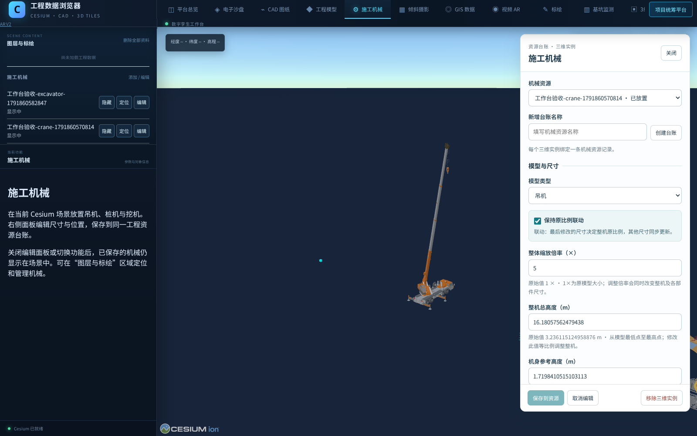

# 施工机械模型接入（2026-10-13）

基于 `codex/platform-reliability-20261009` 的 `19eb1153394ee40b4a1f6d1265659e75d821f919`，在现有管理平台的唯一 Cesium Viewer 中接入吊机、桩机、挖机。没有改变已有工程模型坐标、台账 ID、视频或历史记录。

## 使用

1. 按仓库锁文件安装依赖：`pnpm install --frozen-lockfile`，运行 `pnpm dev`。打开现有 Cesium 工作台根地址 `/`。
2. 从原工作台功能菜单进入“施工机械”，选择设备资源；没有记录时可直接“创建台账”。“项目统筹 → 三维展示 → 施工机械”共用同一个编辑面板、场景对象和资源记录。编辑需要当前项目的 `models` 和 `resource` 权限，有 `models` 权限的用户可查看。
3. 选择吊机、桩机或挖机。默认使用原始模型尺寸，长度单位为 m，整体倍率单位为 ×。
4. 点选场景位置，或填写经度、纬度、椭球高、旋转角。原工作台优先选择当前已加载工程模型表面，管理场景使用其已核验模型表面；未命中时使用地形/参考椭球并明确显示来源。初始位置为空，不会自动保存到 0°、0°。取点成功仅表示取得场景坐标，不代表已核验现场站位精度。
5. 调整尺寸后实时预览；“保存到资源”才写入项目。取消恢复已保存状态，关闭未保存草稿会要求选择继续编辑或放弃。
6. 关闭机械面板或切换到 CAD、倾斜摄影等原有功能，已保存机械仍保留在场景中；从左侧施工机械对象列表进行显隐、定位和编辑。刷新根地址后，按当前账号权限恢复机械位置与参数。“移除三维实例”仅解除模型，机械资源及使用记录保留。

## 平台模块关系

施工机械是原 Cesium 工程数据浏览器的内部模块。两处入口复用主 `Viewer`、同一个机械数据源和面板，以及既有账号、项目资源台账、业务 API 和 SQLite；部署时更新现有仓库、服务和数据目录即可。无需另建机械站点、端口或数据库。

根工作台的后台读取仅同步机械数据与账号权限，不改变已有模型显隐、视频播放或主相机。进入项目统筹后再启用该界面的场景控制。未登录时使用现有统一账号入口；权限撤销或会话失效后，机械数据与编辑状态一并清除。项目仍限于已关联原三维资料库的 `safety:project`。

| 模型 | 可调整参数 |
| --- | --- |
| 吊机 | 整体倍率、整机高度、机身参考高度、吊臂长度、支腿横向间距、支腿纵向间距、吊臂回转角、吊臂仰角 |
| 桩机 | 整体倍率、机身参考高度、整机总高 |
| 挖机 | 整体倍率、整机高度、机身参考高度 |

“保持原比例联动”默认开启：最后修改的尺寸决定整机比例，机身、工作装置和其它尺寸同步。关闭后，吊机吊臂/支腿、桩机桅杆可独立调整；整体倍率及机身参考高度仍控制整机缩放。切换模式本身保留当前外形，下一次修改才按新规则解算。机身参考高度不是单独拉伸机壳。

吊机的“吊臂回转角”通过角度输入或滑块调整，0° 表示源模型原始姿态，正角度为俯视顺时针，360° 与 0° 等效。回转围绕原模型回转支承中心的竖轴进行，吊臂、吊钩、索具及上部回转结构同步转动，底盘和支腿保持原位。该角度与下方“朝向”分别控制上部回转和整车方向；角度不参与尺寸比例联动，改变吊臂长度或整机尺寸时保留当前回转角。“恢复原尺寸”保留角度，“回正”将角度恢复为 0°。点击“保存到资源”后保留回转角，取消编辑恢复已保存姿态。

吊机的“吊臂仰角”以水平面为 0°、竖直方向为 90°，通过数值输入、滑块和上下微调设置。初始仰角约 69.806°，精确值取原模型吊臂轴线；“恢复原仰角”回到该姿态。仰角与水平回转角、吊臂长度可组合调整，吊臂绕根部横向铰轴变幅，吊钩随臂端移动并保持吊索竖直，液压支撑随两端铰点联动。

仰角改变时，底盘、支腿、上车操作室和配重不随吊臂俯仰，设备地理站位及整机朝向不变。整机总高度随当前姿态重新计算；修改整机高度按当前姿态缩放，不强制恢复原仰角。恢复原尺寸保留两个角度，取消编辑恢复已保存姿态。

已有吊机记录缺少回转角时按 0°、缺少仰角时按源模型原仰角读取，不迁移数据库或改写原记录。0–90° 是模型几何示意范围，未标定厂家允许变幅区间。吊索保留原垂距，不自动缩短；低仰角下部件可能低于设备站位基准，面板会显示实算提示，不移动底盘补偿，也不将其视为已通过地形碰撞或安全验算。整机总高沿用最低点至最高点的定义，包含低于站位基准的部件。

坐标采用 WGS84 经度/纬度及**椭球高**，不能直接把未换算的工程正常高填入。旋转角以源模型 +X 参考轴为准，0° 向北、90° 向东；此轴未标定为每类机械的物理车头。GLB 为 Y-up 米制，已减去各自固定地面锚点，Cesium `scale=1`、`minimumPixelSize=0`，不再二次归一化。

## 实际页面

下图为原 Cesium 工作台中的施工机械模块，使用隔离验收数据与提取模型；不代表现场工程复现。



项目统筹内的同一模块可见[管理三维入口截图](machinery-integration/crane-controls.png)。

## 保存与维护

- 模型版本：`2026-10-13-v1`。三类资产共 11 个二进制块，合计 4,838,822 字节，按所需类型加载；没有把原 26 MB 预览 JSON 放入首页 bundle。
- 实例保存在既有设备 `resources[].machinery` 中，沿用 SQLite 修订、并发冲突检查、幂等回执和审计。`machinery.save` / `machinery.remove` 命令同时检查 `models` 与 `resource` 权限。
- 无模型读取权限的响应会移除 `machinery`，覆盖快照、单条记录、历史报告和冲突详情；不会删除数据库中的原值。
- 保存回执丢失时保留草稿，重试沿用请求身份；创建台账也保留同一个设备 ID，避免重复创建。
- 地面锚点不随尺寸漂移；连续修改不会积累上次变形。模式、完整尺寸、吊臂回转角及仰角、可见性、位置随实例保存。替换/移除/切项目时释放旧对象 URL，旧异步任务不会插回模型。
- 几何接口、资产再打包与来源说明见 [`src/machinery/README.md`](../src/machinery/README.md)。技术数值边界不表示厂家允许的作业范围。

## 吊臂仰角验收

70 项相关 Node 测试通过，其中几何与资产 24 项、场景集成 10 项、HTTP/台账/权限等 36 项；TypeScript 检查与 Vite 生产构建通过。重打包 3 个 manifest 和 11 个二进制分块全部逐字节吻合，源模型二进制未修改。

| 检查 | 结果 |
| --- | --- |
| 默认姿态 | 通过，源仰角和原始几何不变 |
| 30° 仰角 | 通过，实际 GLB 吊臂边测得约 29.999998°；30,849 个固定顶点位移为 0 |
| 60° 仰角 | 通过，实际测得约 59.999995°，吊钩保持竖向姿态，双油缸按上下销轴联动 |
| 保存刷新 | 通过，角度、实际模型及设备站位恢复 |
| 取消与立即取消 | 通过，已显示和防抖等待中的草稿均恢复已保存模型 |
| 回转、伸缩、比例组合 | 通过，两个角度独立于尺寸，站位和整机朝向不变 |
| 高度与尺寸恢复 | 通过，输入 12 m 得到实际 12 m；恢复原尺寸保留回转 75°、仰角 30°并重算高度 |
| 滑块端点与定位 | 通过，0°/90°生效，低于基准提示正确，定位视距覆盖水平长臂 |
| 原平台运行 | 通过，唯一 Viewer，零未捕获页面异常、零控制台错误 |

角度测量来自页面实际加载的 GLB 顶点，细微误差来自渲染浮点表示。验收使用隔离数据和软件渲染，未验证现场精度、厂家允许范围或干涉安全。详见[验收记录](machinery-integration/crane-elevation/validation.json)、[原仰角截图](machinery-integration/crane-elevation/01-crane-source-elevation.png)、[30° 截图](machinery-integration/crane-elevation/02-crane-elevation-30.png)、[60° 截图](machinery-integration/crane-elevation/03-crane-elevation-60.png)及[实际操作录像](machinery-integration/crane-elevation/crane-elevation-actual-operation.mp4)。录像为完整浏览器录屏，仅转码缩放。

沿用下方浏览器环境变量，执行 `node tools/verify-crane-elevation.mjs` 可复跑；数据目录为隔离的 `tmp/crane-elevation-*`，结果写入 `output/crane-elevation/`，不读取正式项目数据。设置 `CRANE_ELEVATION_RECORD_VIDEO=1` 可同时录屏，需可用的 Playwright ffmpeg。

## 吊臂回转验收

61 项相关 Node 测试通过，包含原有台账、权限、修订与幂等回归，以及真实源几何、回转后 GLB、角度与缩放组合、旧记录兼容、SQLite 重启恢复。TypeScript 检查与 Vite 生产构建通过。原始模型的二进制文件未修改，重新打包得到的 3 个 manifest 和 11 个分块与仓库文件逐字节一致。

| 检查 | 结果 |
| --- | --- |
| 原工作台创建吊机 | 通过，沿用原模块、台账和唯一 Viewer |
| 0° → 90° 实际模型 | 通过，导出模型中 20,724 个可比较的底盘及固定顶点位移为 0，站位和整机朝向不变 |
| 保存后刷新 | 通过，90° 参数与实际 GLB 顶点校验值均恢复 |
| 取消编辑及立即取消 | 通过，已渲染草稿和防抖等待中的草稿均恢复已保存姿态 |
| 吊臂长度、整机比例 | 通过，调整尺寸保留回转角 |
| 连续操作滑块、360° | 通过，最终角度生效，360° 归零 |
| 尺寸恢复、吊臂回正 | 通过，分别保留角度或尺寸 |
| 页面与场景 | 通过，零未捕获异常、零控制台错误，同一个 Viewer |

使用隔离数据和 Chromium 软件渲染完成实际页面验收；不代表实机运动范围或现场精度验证。完整结果见[验收记录](machinery-integration/crane-rotation/validation.json)，对比可查看 [0° 截图](machinery-integration/crane-rotation/01-crane-rotation-0.png)和 [90° 截图](machinery-integration/crane-rotation/02-crane-rotation-90.png)。[实际操作录像](machinery-integration/crane-rotation/crane-rotation-actual-operation.mp4)为完整浏览器录屏，仅转码和缩放。

```sh
PLAYWRIGHT_MODULE=/absolute/path/to/playwright-core/index.mjs \
BROWSER_EXECUTABLE=/absolute/path/to/chromium \
node tools/verify-crane-rotation.mjs
```

脚本在独立 `tmp/crane-rotation-*` 数据目录运行，输出到 `output/crane-rotation/`。也支持下文的 `BROWSER_LAUNCH_OPTIONS`。

## 模块接入基线验收

54 项 Node 测试通过，包括真实模型资产、GLB、Cesium 坐标变换、加载竞争，以及真实隔离 SQLite/HTTP 的保存重启、权限、并发、幂等和原台账回归：

```sh
node --experimental-transform-types --import ./tools/test-module-loader.mjs --test \
  src/machinery/machinery.test.ts src/machineryIntegration.test.ts \
  server/managementStore.test.ts server/management/reliabilityHttp.test.ts \
  server/management/resourceUsage.test.ts server/management/libraryPermissions.test.ts \
  server/management/machineryHttp.test.ts
pnpm build
```

真实 Chromium + WebGL2 页面验收覆盖三种模型创建/放置/调尺寸/保存、取消、独立吊臂、刷新恢复、挖机机身高度联动、移除保留台账、唯一 Viewer。另验证保存已提交但响应丢失后的幂等重试、草稿关闭/继续/丢弃、Esc 取消拾取。页面无未捕获异常。浏览器使用 SwiftShader 软件渲染，未将此结果计作现场 GPU 性能或工程精度验收。

可复跑实际页面测试（需自行安装 Playwright 与可运行的 Chromium）：

```sh
PLAYWRIGHT_MODULE=/absolute/path/to/playwright-core/index.mjs \
BROWSER_EXECUTABLE=/absolute/path/to/chromium \
node tools/verify-machinery-platform.mjs
```

测试脚本创建独立 `tmp/machinery-platform-*` 数据目录，输出到 `output/machinery-integration/`；不读取或修改正式 `project-data/`。特殊浏览器环境可用 `BROWSER_LAUNCH_OPTIONS` 指向导出 Playwright launch options 的本地模块。

原工作台模块接入补充完成 **15 项真实浏览器检查**：根地址直接进入、三类机械创建保存、后台同步保留原场景/相机/渲染循环、切换 CAD 与倾斜摄影、对象列表显隐/定位/同实例编辑、双向草稿保护、管理入口往返、唯一 Viewer/面板/数据源、根地址刷新恢复，以及真实会话吊销后清空实体与编辑状态。使用一份模拟工程实体检查场景保留，未拿模拟数据替代现场坐标精度验证。结果见[完整验收记录](machinery-integration/workbench-validation.json)。

原管理入口的 9 项页面流程回归、54 项 Node 测试以及 TypeScript/Vite 生产构建均通过。新增浏览器检查没有未捕获页面异常；吊销会话步骤中的两条 401 是预期结果。原工作台中文字体使用仓库已有 Noto Sans SC 回退，机械对象按钮明确设置对比色。

使用与上方相同的浏览器环境变量，执行 `node tools/verify-machinery-workbench.mjs` 可复跑原工作台验收；其数据目录为独立 `tmp/machinery-workbench-*`，结果输出到 `output/machinery-workbench/`。

## 边界与回退

本轮实现模型接入、编辑和持久化。尚未实现铁路安全限界选取、防护人员覆盖范围、倾覆包络及侵限计算；模型显示与保存不会将设备标记为报验合格。材质保留源基础颜色，未恢复完整纹理/透明材质。没有提供现场实景工程和实测控制点，因此未验证实际站位精度、地表高程转换或安全距离。

现有平台三维仍限于 `safety:project`，其它项目须先接入独立实景资料库。未扩展原有项目访问范围。

回退时撤销本次接入提交并恢复前端构建即可，无数据库结构迁移。回退前备份正常项目数据；旧版本可能忽略资源的 `machinery` 字段，应保留该字段以便重新启用。需要仅停用某设备显示时，优先在面板中取消“在三维场景显示”或解除三维实例。

吊臂姿态分别保存在 `parameters.boom_rotation_deg` 和 `parameters.boom_elevation_deg`。不支持相应字段的旧版会拒绝显示已保存新参数的吊机，因此不能只回退前端后就宣称数据兼容。需回退时先保留原始设备参数与数据库备份，在数据副本中验证兼容处理：恢复目标版本支持的姿态，重新解算 `overall_height_m`，再删除目标版本不支持的角度字段。尤其不能只删除仰角字段而保留另一姿态的整机高度。其他尺寸、位置与设备 ID 保持不变，不得用旧数据库整库覆盖后续新增台账。
