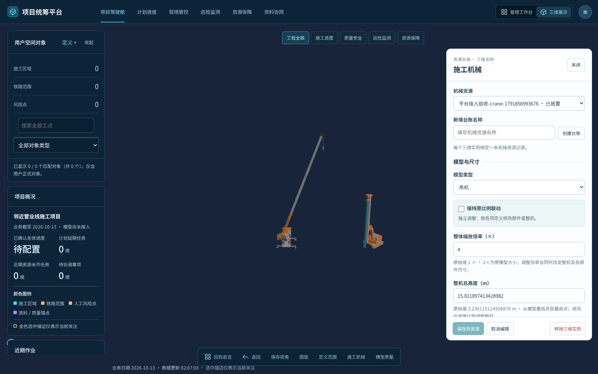

# 施工机械模型接入（2026-10-13）

基于 `codex/platform-reliability-20261009` 的 `19eb1153394ee40b4a1f6d1265659e75d821f919`，在现有管理平台的唯一 Cesium Viewer 中接入吊机、桩机、挖机。没有改变已有工程模型坐标、台账 ID、视频或历史记录。

## 使用

1. 按仓库锁文件安装依赖：`pnpm install --frozen-lockfile`，运行 `pnpm dev`。打开 `/?screen=management`。
2. 进入“三维展示 → 施工机械”，选择设备资源；没有记录时可直接“创建台账”。编辑需要当前项目的 `models` 和 `resource` 权限，有 `models` 权限的用户可查看。
3. 选择吊机、桩机或挖机。默认使用原始模型尺寸，长度单位为 m，整体倍率单位为 ×。
4. 点选场景位置，或填写经度、纬度、椭球高、旋转角。优先选择当前已核验实景模型表面，未命中时使用地形/参考椭球并明确显示来源。初始位置为空，不会自动保存到 0°、0°。
5. 调整尺寸后实时预览；“保存到资源”才写入项目。取消恢复已保存状态，关闭未保存草稿会要求选择继续编辑或放弃。
6. 刷新浏览器后重新进入三维页，位置与参数自动恢复。“移除三维实例”仅解除模型，机械资源及使用记录保留。

| 模型 | 可调整参数 |
| --- | --- |
| 吊机 | 整体倍率、整机高度、机身参考高度、吊臂长度、支腿横向间距、支腿纵向间距 |
| 桩机 | 整体倍率、机身参考高度、整机总高 |
| 挖机 | 整体倍率、整机高度、机身参考高度 |

“保持原比例联动”默认开启：最后修改的尺寸决定整机比例，机身、工作装置和其它尺寸同步。关闭后，吊机吊臂/支腿、桩机桅杆可独立调整；整体倍率及机身参考高度仍控制整机缩放。切换模式本身保留当前外形，下一次修改才按新规则解算。机身参考高度不是单独拉伸机壳。

坐标采用 WGS84 经度/纬度及**椭球高**，不能直接把未换算的工程正常高填入。旋转角以源模型 +X 参考轴为准，0° 向北、90° 向东；此轴未标定为每类机械的物理车头。GLB 为 Y-up 米制，已减去各自固定地面锚点，Cesium `scale=1`、`minimumPixelSize=0`，不再二次归一化。

## 实际页面

下图为真实平台与提取模型的隔离验收场景，不是现场工程复现。



## 保存与维护

- 模型版本：`2026-10-13-v1`。三类资产共 11 个二进制块，合计 4,838,822 字节，按所需类型加载；没有把原 26 MB 预览 JSON 放入首页 bundle。
- 实例保存在既有设备 `resources[].machinery` 中，沿用 SQLite 修订、并发冲突检查、幂等回执和审计。`machinery.save` / `machinery.remove` 命令同时检查 `models` 与 `resource` 权限。
- 无模型读取权限的响应会移除 `machinery`，覆盖快照、单条记录、历史报告和冲突详情；不会删除数据库中的原值。
- 保存回执丢失时保留草稿，重试沿用请求身份；创建台账也保留同一个设备 ID，避免重复创建。
- 地面锚点不随尺寸漂移；连续修改不会积累上次变形。模式、完整尺寸、可见性、位置随实例保存。替换/移除/切项目时释放旧对象 URL，旧异步任务不会插回模型。
- 几何接口、资产再打包与来源说明见 [`src/machinery/README.md`](../src/machinery/README.md)。技术数值边界不表示厂家允许的作业范围。

## 本轮验收

54 项 Node 测试通过，包括真实模型资产、GLB、Cesium 坐标变换、加载竞争，以及真实隔离 SQLite/HTTP 的保存重启、权限、并发、幂等和原台账回归：

```sh
node --experimental-transform-types --import ./tools/test-module-loader.mjs --test \
  src/machinery/machinery.test.ts src/machineryIntegration.test.ts \
  server/managementStore.test.ts server/management/reliabilityHttp.test.ts \
  server/management/resourceUsage.test.ts server/management/libraryPermissions.test.ts \
  server/management/machineryHttp.test.ts
pnpm build
```

真实 Chromium + WebGL2 页面验收覆盖三种模型创建/放置/调尺寸/保存、取消、独立吊臂、刷新恢复、挖机机身高度联动、移除保留台账、唯一 Viewer。另验证保存已提交但响应丢失后的幂等重试、草稿关闭/继续/丢弃、Esc 取消拾取。页面无未捕获异常。浏览器使用 SwiftShader 软件渲染，未将此结果计作现场 GPU 性能或工程精度验收。

可复跑实际页面测试（需自行安装 Playwright 与可运行的 Chromium）：

```sh
PLAYWRIGHT_MODULE=/absolute/path/to/playwright-core/index.mjs \
BROWSER_EXECUTABLE=/absolute/path/to/chromium \
node tools/verify-machinery-platform.mjs
```

测试脚本创建独立 `tmp/machinery-platform-*` 数据目录，输出到 `output/machinery-integration/`；不读取或修改正式 `project-data/`。特殊浏览器环境可用 `BROWSER_LAUNCH_OPTIONS` 指向导出 Playwright launch options 的本地模块。

## 边界与回退

本轮实现模型接入、编辑和持久化。尚未实现铁路安全限界选取、防护人员覆盖范围、倾覆包络及侵限计算；模型显示与保存不会将设备标记为报验合格。材质保留源基础颜色，未恢复完整纹理/透明材质。没有提供现场实景工程和实测控制点，因此未验证实际站位精度、地表高程转换或安全距离。

现有平台三维仍限于 `safety:project`，其它项目须先接入独立实景资料库。未扩展原有项目访问范围。

回退时撤销本次接入提交并恢复前端构建即可，无数据库结构迁移。回退前备份正常项目数据；旧版本可能忽略资源的 `machinery` 字段，应保留该字段以便重新启用。需要仅停用某设备显示时，优先在面板中取消“在三维场景显示”或解除三维实例。
