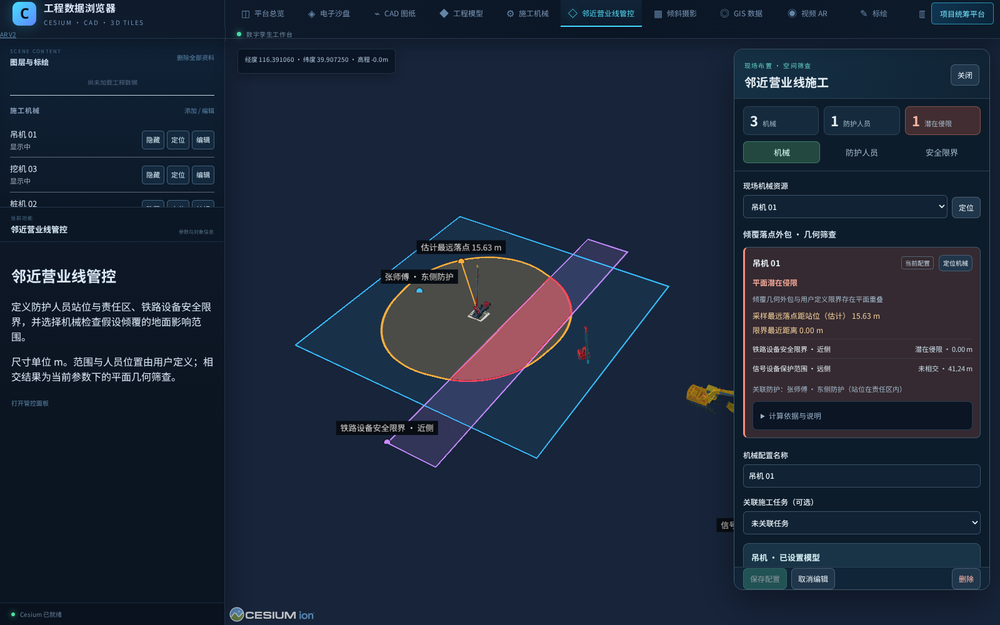

# 邻近营业线施工管控

## 功能与入口

本模块在原 Cesium 工作台“邻近营业线管控”和项目统筹的三维工具栏中打开，共用已有 Viewer、设备资源、项目账号和 SQLite。机械编辑仍在原“施工机械”面板完成。

用户定义防护人员站位、责任区域及关联机械，定义铁路设备安全限界多边形，为机械选用一个或多个限界。报验只保留人工标记，不增加报验表、附件审批或自动合格判断。人工站位不代表实时定位或已确认到岗。

长度单位为 m；经纬度是 WGS84 度，输入高程是椭球高。已有倾斜摄影、模型、原视频、铁路人工范围和历史记录保持原位与稳定 ID。新增限界不自动把旧铁路范围转换成核定工程边界。

## 数据关系

新增 `railSafety` 管理集合，记录沿用管理记录的 `id/projectId/revision/name/taskId/createdAt/updatedAt`。

| definition.kind | 内容 |
| --- | --- |
| guard | 人员站位、责任区多边形、关联设备资源编号 |
| limit | 用户定义的铁路设备安全限界多边形 |
| machine | 设备资源编号、选用限界编号、人工报验状态、可选支承范围修正 |

`railSafety.save` 和 `railSafety.remove` 沿用修订校验、幂等回执及审计。移除为软删除。数据保存在已有管理数据库中，不新增另一套登录或浏览器本地正式数据源。

模型查看权限控制读取；模型与资源权限共同控制编辑。任务授权继续约束关联记录。草稿仅预览，保存成功后成为正式定义；取消恢复已保存范围。显隐仅控制显示，不从已选限界评估中移除对象。

## 计算口径

倾覆影响范围表示：按当前机械尺寸、姿态和支承位置，在假设倾覆方向上求可能最远落地点，形成地面影响外包。机械高度、吊臂长度和水平工作半径不直接作为倾覆半径。

首版采用水平参考地面、固定支承线、无滑移和无解体的几何筛查。模型全部部件参与；从模型估计的支承位置与用户输入的支承范围均须明确标识来源。允许单个几何点绕支承线落地形成保守外包，不模拟整机首次触地后停止、结构变形、地基破坏或动力过程，因此不是实机倒伏试验或稳定性验算。

机械站位、整机方向、尺寸、吊臂回转和仰角改变后更新当前预览。取消机械修改恢复已保存工况。机械与限界的数据签名用于阻止旧异步计算覆盖新状态。选择失效限界、模型加载失败或无法计算时显示资料/参数不足，不给出安全结论。

与用户限界进行平面相交判断，区分潜在侵限、边界接触、未发现相交和无法判定。未相交时显示最近水平距离。重叠结果不代表三维实体实际碰撞；接触网等立体设备仍需完整高程和三维范围。

人员关联检查仅说明机械站位是否位于该人员自定义责任区，不能推定人员在岗、可视通达或完整作业区域均获得防护。没有自动创建正式安全事件，也没有自动批准开工。

## 交互

1. 在施工机械中布置设备，填写尺寸与位置并保存。
2. 打开邻近营业线管控，新增人员，点选站位、绘制责任区并关联机械。
3. 新增限界，绘制多边形并命名保存。
4. 选择机械，选择需要比较的限界，必要时修正支承范围并保存。
5. 查看橙色影响外包、紫色限界、蓝色责任区和红色相交片。点击结果可定位。
6. 进入机械参数编辑，修改站位或姿态观察范围更新；保存或取消后核对对应结果。

绘制和输入校验失败时保留草稿。切换账号、项目或权限撤销时清理受限数据与交互。测试与演示使用隔离数据，不写正式工程数据目录。

## 验证与限制

95 项 Node 测试通过（既有机械/管理回归 73 项，落点几何 12 项，场景联动 5 项，新增 HTTP/权限 5 项），TypeScript 与 Vite 生产构建通过。构建仍提示既有大体积主包；本模块几何 Worker 单独打包，不把几何运算放在动画帧中。

真实 Chromium 浏览器 13/13 项检查通过，使用隔离 SQLite、提取机械模型和人工测试位置，未加载现场倾斜摄影。无未捕获页面异常；并发冲突用例有一条预期 HTTP 409 日志，其余无控制台错误。

| 检查 | 实际结果 |
| --- | --- |
| 原工作台入口 | 新面板使用原 Viewer，真实 Worker 已加载；未选限界显示未知 |
| 人员定义 | 场景实际点选站位，手输责任区，关联两台机械并保存 |
| 限界定义 | 四点场景绘制与坐标输入分别保存为不同限界 |
| 多限界选用 | 同一机械同时选用近侧和远侧限界，分别输出结果 |
| 潜在侵限 | 检查实际 Cesium 红色相交实体及其颜色，非仅查看文字 |
| 边界接触 | 用户输入的相切边界得到接触状态及红色边线 |
| 显隐 | 隐藏限界图层后选用清单和计算结果保持 |
| 参数预览与取消 | 几何估计最远距离由 15.6349 m 改为 20.6687 m，取消恢复原值；资源未被保存 |
| 草稿导航 | 未保存修改阻止离开，取消恢复原记录 |
| 刷新 | 5 条定义、原 ID 和已保存选用关系保留 |
| 并发绘制 | 收到其它修订仍保留旧版本，提交返回 409，未覆盖服务器内容 |
| 只读 | 原只读账号可查看，修改控件禁用，真实 API 写入被拒绝 |
| 运行时 | 唯一 Viewer、机械数据源和管控数据源，原机械仍可显示 |

参数预览期间观测到动画帧继续推进，其中 2 帧处于计算等待状态；这仅验证后台计算路径，没有测得现场设备 FPS 保证。几何方法具有采样与保守外包余量，面板中的“采样最远落点”不等于实体精确最终落点。

实际证据：[完整验收矩阵](rail-safety/validation.json)、[操作录像](rail-safety/rail-safety-actual-operation.mp4)（197.84 秒、1600×1000、25 fps，仅转码）、[副本回退验证](rail-safety/rollback-validation.json)。



其它截图：[防护人员](rail-safety/02-guard-station-and-responsibility.png)、[限界绘制](rail-safety/03-user-defined-railway-limit.png)、[机械参数联动](rail-safety/04-machine-pose-live-preview.png)、[刷新恢复](rail-safety/05-persisted-configuration.png)、[边界接触](rail-safety/06-boundary-contact.png)。

复现命令：

```sh
node --experimental-transform-types --import ./tools/test-module-loader.mjs --test \
  src/railSafetyGeometry.test.ts src/railSafetyScene.test.ts server/management/railSafetyHttp.test.ts \
  src/machinery/machinery.test.ts src/machineryIntegration.test.ts server/managementStore.test.ts \
  server/management/reliabilityHttp.test.ts server/management/resourceUsage.test.ts \
  server/management/libraryPermissions.test.ts server/management/machineryHttp.test.ts
npm run build
PLAYWRIGHT_MODULE=/absolute/path/to/playwright-core/index.mjs \
BROWSER_LAUNCH_OPTIONS=/absolute/path/to/launch-options.mjs \
RAIL_SAFETY_RECORD_VIDEO=1 node tools/verify-rail-safety.mjs
```

脚本环境变量以 `tools/verify-rail-safety.mjs` 顶部注释为准；所有写入使用独立 `tmp/rail-safety-browser-*`。机械初始资源通过测试 API 建立，人员、限界、关联和编辑操作通过真实产品控件完成。

真实现场模型坐标、高程转换、机械支承位置及铁路设备限界精度需要现场资料与独立控制点验证，当前不宣称已完成。未实现三维设备限界碰撞、地基或荷载稳定性验算、机械解体或滑移、实时人员定位。未在用户电脑部署。

本地实施提交：数据与权限 `55ce544`，几何计算 `a813b9b`，平台界面、交互及后台计算 `0222a95`。代码从 `d0ed4a5` 向前实施，无回退覆盖。

## 回退

先停止服务并备份完整管理数据目录。日常删除使用模块软删除，不直接修改数据库。

需要撤下新界面时，回退到本模块的数据兼容提交 `55ce544`，或只撤销后续界面和几何批次，保留该提交的数据读取能力。新增定义仍保存在数据库中，原机械台账和旧平台可继续读取。回退前必须在数据库副本验证，不能在正式数据上试错。

已通过 `tools/verify-rail-safety-rollback.mjs` 验证：用 SQLite backup 从浏览器隔离数据库取得一致副本，以 `55ce544` 的独立工作树读取，5 条管控定义和 3 台机械可读，记录、历史版本、审计及幂等回执内容哈希前后一致。

不得直接用 `d0ed4a5` 或更早代码读取已含 `railSafety` 集合的数据库：旧读取器不支持未知集合，会出错。若必须完整回到该版本，应使用升级前的数据库备份，并保留当前完整备份，逐项核对升级期间的其它业务新增记录；不能以旧备份直接覆盖当前唯一数据副本。
