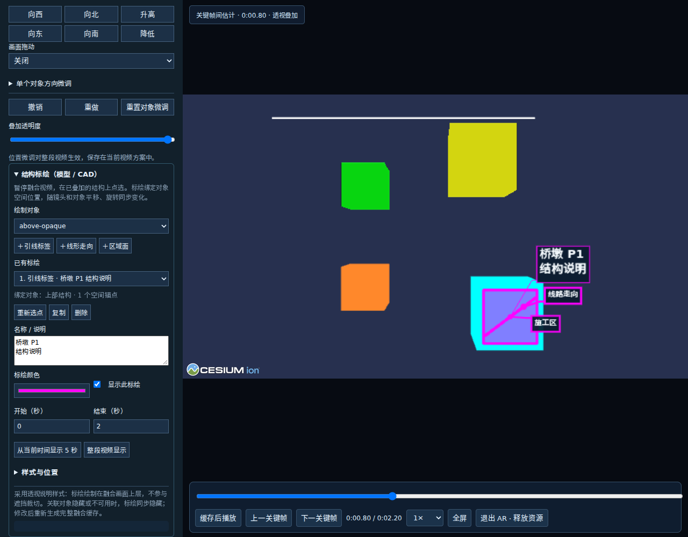

# 视频融合结构标绘

结构标绘用于在航拍融合视频中说明桥墩、盖梁、线路、管线及施工范围。锚点保存在所选模型或 CAD 的局部坐标系中，每个视频帧使用同一组融合相机参数投影；镜头变化及对象位置微调后，标绘仍指向对应结构。

## 使用方法

1. 按原有流程载入视频、空三数据及已定位的模型/CAD，进入 AR 融合编辑，暂停到结构清晰可见的画面。正在播放缓存时，点击“返回融合编辑”。
2. 展开“结构标绘（模型 / CAD）”，选择绘制对象。
3. 选择标绘类型，在画面中点选该对象：
   - **引线标签**：点击一个结构表面或 CAD 线段，填写名称与说明。
   - **线形走向**：依次点选两个及以上位置，点击“完成绘制”或按 Enter。箭头方向取决于点选顺序，可开启流动效果。
   - **区域面**：依次点选三个及以上边界点，完成后自动闭合，最后一点无需重复首点。
4. 设置出现、结束时间，也可选择“整段视频显示”。调整文字、颜色、线宽及区域填充；文字水平/垂直偏移只改变说明卡片位置，结构锚点保持不动。
5. 保存融合方案，点击“生成完整融合缓存”。标绘与模型、原视频一起写入缓存，完成后播放或导出。修改标绘后须生成新缓存。

绘制中可以撤回上一点；Esc 取消未完成的标绘。已有标绘支持重新选点、复制、隐藏、删除。原来的画面文字、箭头等二维标注继续可用。

## 工程汇报用法

| 类型 | 建议内容 | 示例 |
| --- | --- | --- |
| 引线标签 | 结构名称、施工状态、关键说明 | 6号墩盖梁／计划施工时段；邻近既有线承台／施工边界说明 |
| 线形走向 | 既有铁路、拟建轴线、管线、通道 | 箭头注明上下行方向或施工车辆行进方向 |
| 区域面 | 作业范围、防护范围、开挖范围 | 半透明填充保留底下实景，边线强调范围 |

同一画面建议突出少量重点对象，利用显示时段依次讲解。标签使用深色底、引线和锚点，自动进行基本避让；颜色由用户统一设置。

## 空间与显示规则

- 模型取点使用真实表面深度；CAD 线段优先吸附保留的实际线段坐标。未命中所选资源、点击空白、无有效深度或无法确定图元位置时提示重选，不生成屏幕坐标替代点。
- 一条标绘绑定一个资源。跨多个导入资源的线路或区域应分别绘制；当前不支持自动追踪整个 CAD 图层、单独构件动画或拓扑更换后的自动重新关联。
- 线和面连接所选三维顶点，不自动沿曲面细分贴合。曲线或复杂范围可增加取点；区域须按边界顺序点选。
- 采用**透视说明**：标绘作为汇报图层显示在融合画面上方，不进行逐像素遮挡裁切。模型本身继续使用既有遮挡流程。需要说明地下结构或被遮挡构件时，应在文字中明确说明。
- 目标未参与融合、不可用或在模型展示时段中隐藏时，其标绘同步隐藏。标签锚点出画或到达相机背面时隐藏；区域顶点跨相机背面时保守隐藏区域，避免生成错误大面。
- 保存数据包含资源 ID、局部顶点、文字、样式和显示时间。旧方案没有结构标绘字段时仍可正常打开。资源删除后保留标绘数据并提示重新关联，不自动转为画面贴图。

## 缓存与实现

入口为 `videoModelOverlay.ts` 的“结构标绘”面板；`videoOverlaySpatialBinding.ts` 负责拾取、局部坐标和相机投影；`videoOverlaySpatialAnnotations.ts` 负责确定性的时间与绘制；`videoOverlaySpatialEditor.ts` 负责编辑。

结构标绘参与方案自动保存及缓存签名。缓存生成时使用实际源帧时间计算标绘，保留源视频分辨率和帧时间；缓存播放仍是独立视频播放，不恢复 Cesium 逐帧渲染。文字、颜色或锚点修改会使完整融合缓存失效；当前不单独维护标绘图层缓存。

## 设计参考

- [ArcGIS Motion Imagery 视频空间要素标绘](https://doc.esri.com/en/arcgis-pro/latest/help/analysis/image-analyst/add-features-to-your-video-in-fmv.html)：点、折线、多边形在视频与地图之间对应。
- [ArcGIS 三维引线标签示例](https://developers.arcgis.com/javascript/latest/sample-code/visualization-label-callout/index.html)：引线关联真实落点，文字描边和重叠处理提高可读性。
- [Trimble SiteVision 桥梁 BIM 与现场 AR 案例](https://www.trimble.com/en/blog/construction/article/visualize-your-bim-model-using-ar-technology)：用于工程对象与现场关系表达的应用参考。

以上参考用于交互设计；本功能的可用范围以本文和实际验收结果为准。

## 验证入口

单元测试：

```bash
node --experimental-transform-types --test src/videoOverlaySpatialAnnotations.test.ts src/videoOverlaySpatialBinding.test.ts src/videoOverlayAnnotations.test.ts src/videoOverlayResources.test.ts src/videoOverlayEffects.test.ts src/videoOverlayNativeCache.test.ts src/videoOverlayCacheStore.test.ts
```

浏览器验收：

```bash
node tools/verify-video-overlay-spatial.mjs
```

浏览器脚本需要 Playwright/Chromium、FFmpeg 和 ffprobe；可用 `PLAYWRIGHT_MODULE`、`BROWSER_EXECUTABLE`、`OUTPUT_DIR` 指定环境。脚本使用合成模型、CAD 线和视频，验证实际表面拾取、镜头及对象变化、保存恢复、源帧缓存和退出清理。真实现场模型、航拍视频及 Windows 显卡仍须在原部署环境验收。

验收结果：65 项相关单元测试、7 项浏览器验收通过，生产构建通过。浏览器样例缓存保持 640×360 分辨率和全部 18 个源视频帧，播放阶段没有实时融合回调。

下图为合成场景的功能验收截图，不是现场配准效果示例。品红色用于自动像素识别，日常标绘可自选颜色。


